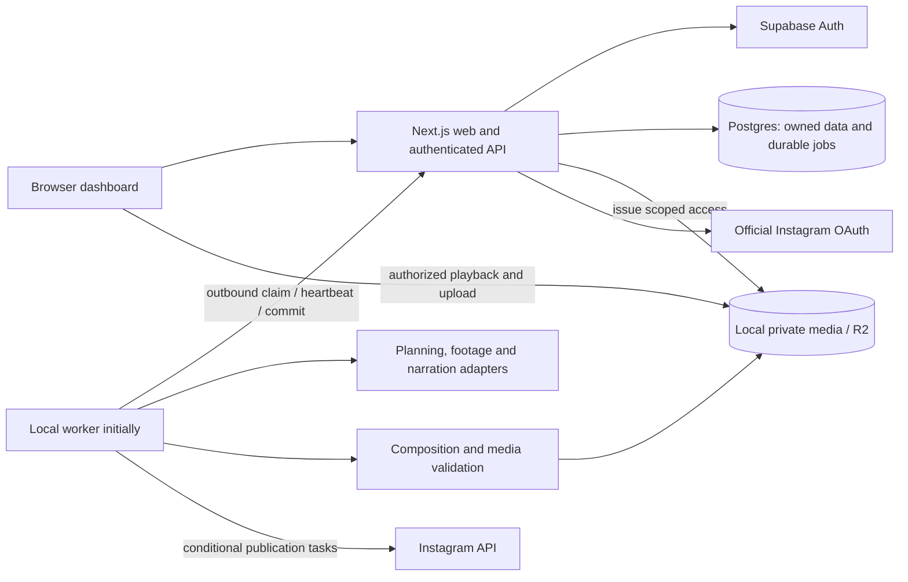
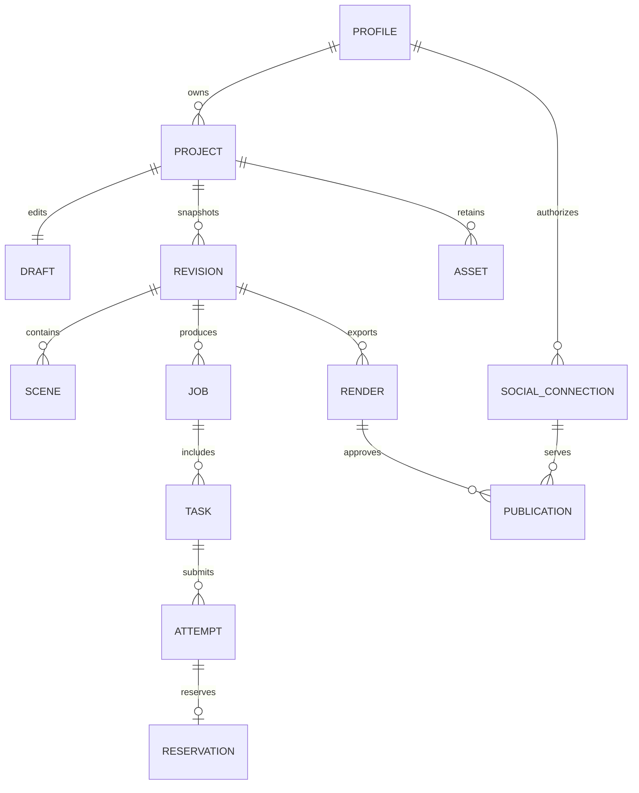

# Vydrivo — Dashboard System Design

Version: 1.2
Date: 26 October 2026
Status: Design specification; authenticated dashboard implemented in slices; see section 20
Product requirements: [PRD V1, version 1.3](PRD-V1.md)
Generation internals: [Pipeline Technical Design & Prototype Plan](PIPELINE-TECHNICAL-DESIGN.md)
Detailed contracts: [API design](API-DESIGN.md) · [Database design](DATABASE-DESIGN.md)

## 1. Purpose, authority and current state

Design the authenticated product through which users plan, generate, revise, manage and publish videos. This includes the dashboard home, project workspace, library, calendar, account controls and their supporting backend. It is not merely a dashboard landing screen.

The PRD controls product scope; this document proposes implementation contracts and defaults. The pipeline design controls media stages. Latest user preferences take precedence where they differ: both requested ElevenLabs voices remain saved preferences, but availability and rights must be verified before exposing them as usable. Do not silently substitute Kokoro or a Mac voice.

Dashboard design is authorized; dashboard implementation remains unstarted. Local
pipeline implementation is underway: actual short footage exists, saved ElevenLabs
narration/captions exist for graphics fixtures, and a storyboard adapter plus
validated data-driven renderer have been added. Live Gemini generation, preferred
voice access and the complete automated 60–90-second footage workflow remain
unverified. Existing graphics exports do not satisfy the actual-footage gate.
No cloud provisioning or spending is authorized by this document alone.

## 2. Fixed scope and design assumptions

- Actual AI moving footage is mandatory in V1; template animation and still-image effects cannot satisfy the requirement. Default scene plans use generated footage, with explicitly approved supplementary graphics.
- Output is vertical 1080 × 1920 MP4, 60–90 seconds; AI selects length and users revise conversationally. Thirty-second videos remain internal test fixtures only.
- One operational video provider. Model and capability selection are operator configuration, not a V1 model marketplace.
- English first. Conditional image references; no arbitrary URL/PDF import. No branding controls, professional timeline editor, collaboration, customer usage dashboard or payments in V1.
- One account owns each project; no organizations or shared editing permissions. A five-user private pilot is the initial capacity assumption, not a guaranteed service level.
- Initial incremental service spend remains ₹0. Internal quotas, cost reservations and emergency stop controls are mandatory despite the absence of a customer credit UI.
- Instagram connection/publication require official access and successful tests. Automatic scheduling additionally requires a continuously available worker. Manual export/upload is always supported.
- Local application and worker first. Authorized hosted pilot: Amplify web tier, Supabase Auth/Postgres, private R2 media; EC2 deferred until continuous worker operation is justified.

## 3. Information architecture and screen contracts

| Route / screen | Content and primary action | Required states |
|---|---|---|
| `/sign-in`, `/sign-up`, `/recover`, `/auth/callback` | Email/password registration, login and recovery through Supabase; verify email before external pilot access | Pending verification, invalid/expired link, throttled request, expired session; generic recovery response |
| `/app` | Create video, recent projects, drafts needing review, active jobs and completed outputs | First-use guidance, loading, empty, offline worker, recoverable error; no credit or revenue tiles |
| `/app/projects` | Search own titles, filter status, sort latest updated, cursor pagination | Empty search, loading next page, failed load; no fabricated activity |
| `/app/projects/new` | Topic, pasted notes or brainstorm; optional conversational audience/tone | 10,000-character limit, validation, planning queued/failed, editable concept selection |
| `/app/projects/:id` | Combined storyboard, scene list, narration and visual intent, revision conversation, Generate | Saving/unsaved/conflict, approval needed, capability unavailable, running and failed generation |
| `/app/projects/:id/preview` | Actual render player, selected revision, source quality disclosure, scene edits, export/publish | No render yet, expired media URL, old successful version while replacement runs, playback error |
| `/app/library` | Owned clips, narration, reference assets and exports, grouped by project/type | Validated/pending/failed/expired asset, retention notice; no public gallery of user work |
| `/app/calendar` | Planned/manual and scheduled/automatic publications; month/list views | Timezone, empty calendar, missed schedule, reconnection needed, failed/canceled/published |
| `/app/settings` | Display name, timezone, sign-out, recovery link, connection management and retention explanation | Save/error, disconnected/expired Instagram; no API-key, subscription or brand settings |
| `/app/help` | Short onboarding, supported inputs, retry/export guidance, source-quality explanation | Static useful content; no unimplemented capabilities advertised |

Public landing/use-case/tutorial/sample routes are separate from `/app`. Their SEO requirements remain in PRD section 13. They must not query private projects to populate samples, sitemap entries or structured data.

Layout: desktop sidebar navigation plus project workspace; on mobile use compact navigation and stacked scene/review/preview panels. Keep Create video and current project status visible. Default dashboard results: 20 projects per page, maximum API page size 50. Search is title-only initially; private script indexing and semantic search are unnecessary.

### Workspace behavior

1. User chooses an idea and reviews narration, visuals and timing together.
2. Direct edits or conversation produce a draft. Conversation shows a proposed scene-level change summary before applying a destructive/global update.
3. Generate approves a precise saved revision and queues work. Unsaved text cannot be silently omitted.
4. Show task counts and stage names, not invented percentages or guaranteed completion times.
5. Preview plays the rendered artifact, not an animation that merely resembles the expected result. Clearly label the revision and whether newer edits are unrendered.
6. Caption correction, trim, reorder or clip regeneration creates a new draft/revision. A working previous render remains downloadable until replacement succeeds.
7. Export downloads an existing accepted render; it does not trigger another paid generation.
8. Publish is a separate explicit action on a specific render and caption. Generation success never implies publishing approval.

Each footage scene displays a thumbnail, visual prompt/intent, narration and measured/estimated timing as applicable. Keep provider plumbing and cost ledger out of normal product copy; show actionable messages such as “Generation paused: free allowance unavailable.” Show native footage quality separately from export size.

## 4. Architecture and deployment boundaries



Use a modular monolith, not microservices: one Next.js application and one separate worker executable/process, with shared schemas and typed contracts. Do not add Redis, Kafka, Kubernetes, a search cluster or a realtime service to the private pilot.

| Layer | Implementation responsibility |
|---|---|
| Presentation | Server-rendered app shell; client components for editor, player, conversation, calendar and autosave |
| Application services | Auth/ownership, validation, draft/revision operations, enqueueing, read projections, media authorization and publication approval |
| Persistence | Postgres transactions, constraints, row-level security, indexes, durable attempts and budget reservations |
| Worker | Pipeline execution, leases, remote reconciliation, normalization/rendering and cleanup; no browser dependency |
| Provider adapters | Planning, video, voice, storage and Meta operations behind capability-aware contracts |
| Operations | Configuration, feature flags, secret handling, audit events, metrics and budget/expiry alerts |

Proposed code boundaries when implementation starts: `app` routes/layouts, `components` screen elements, `domain` schemas/state rules, `server` services/repositories, `worker` execution, and `providers` adapters. Share validation schemas across UI/server/worker but always validate server-side.

Hosted web handlers return promptly and never execute FFmpeg or long video generation. Use polling rather than requiring streaming/Edge APIs; pin a security-patched framework/runtime combination supported by Amplify at implementation time. Public pages may be static. Authenticated responses are private/no-store and excluded from shared CDN caches.

Keep browser media traffic direct to private object storage through short-lived authorized links. Do not proxy entire MP4 downloads through Amplify. A local worker calls restricted outbound APIs; it does not expose a laptop port. Later EC2 runs the same worker contract after separate sizing, deployment and budget approval.

## 5. Identity, authorization and session design

Supabase Auth owns identity/passwords; Vydrivo stores a profile keyed by the auth subject. Use email/password with email verification and reset links for the pilot; email delivery must be tested before invitations. Do not build a password store or assume free email quotas are sufficient. Social login is unnecessary in V1.

Use the supported server-side session integration with appropriately secured cookies; validate the session server-side on protected reads and every mutation. Do not trust an owner ID from JSON, route parameters or browser state. Set secure/same-site attributes, validate Origin for mutations, and use CSRF protection where applicable. Session expiry preserves the visible unsaved editor buffer and asks for sign-in rather than discarding it.

Enforce ownership in application services and Postgres RLS. Prefer user-scoped database operations in request handlers. Privileged background access belongs to restricted server-side operations, never the browser. UUIDs are identifiers, not authorization.

Roles: owner-user and internal operator only. Operator access is a separate server-side identity and explicitly audited; do not infer operator privileges from an editable profile field. No web admin console is required in V1. Workers authenticate with a revocable, scoped service credential and receive job-specific grants; a worker cannot browse arbitrary users or sign arbitrary asset paths.

## 6. Data model and database invariants

Use UUID primary keys, UTC `timestamptz`, versioned JSONB only for structured scene/provider details, and relational columns for ownership, lifecycle and relationships. Store media in object storage, never database byte columns.



| Table | Key fields / rules |
|---|---|
| profiles | auth user ID, display name, IANA timezone; never billing privileges or plaintext credentials |
| projects | owner ID, title, original notes, current draft version, latest successful render ID, lifecycle, deleted_at |
| drafts | unique project ID, version integer, base revision ID, schema version, editable scene JSON; compare-and-swap updates |
| revisions | project/owner, parent revision, snapshot hash, approved_at/by; immutable once inserted/approved |
| scenes | revision ID, stable scene ID across revisions, order, narration, visual kind/prompt, optional reference; unique revision/order |
| assets | project/owner, kind, key, checksum, bytes, MIME, validation status, native properties, provenance, expires_at |
| scene_assets | scene revision/asset association, role, trim bounds; validate ownership and revision consistency |
| narration_segments | revision/scene, text, voice/version, asset, sample timing and caption cues |
| jobs | revision/owner, kind, lifecycle, waiting reason, client idempotency key, progress version, cancellation intent |
| tasks | job/stage/dependencies, lease token/expiry, heartbeat, retry count/next-attempt time, output references |
| attempts | task/logical request ID, provider/model, request hash, remote ID, state, sanitized error, timestamps |
| budget_authorizations | operator authorization reference, service/currency/expiry, total and per-job ceilings |
| reservations / cost_ledger | attempt reference, maximum reserved cost, confirmed actual charges/refunds, currency and rate snapshot; append-only financial events |
| renders | revision/manifest hash, output asset, dimensions/codecs/duration, validation result; immutable |
| social_connections | owner, remote account ID, status, encrypted token reference, scopes, expiry; never expose token in API reads |
| publications | owner/project/render, immutable approved caption snapshot, UTC time + IANA zone, status, remote ID, uncertain-response state |
| audit_events | actor, entity IDs, action, timestamp, correlation ID; redacted metadata only |

Essential constraints:

- Foreign-key relationships must enforce same owner/project, using composite keys where practical plus service validation. RLS must cover child tables, not only projects.
- Unique `(owner_id, operation, idempotency_key)` semantics for submissions; reusing a key with a different payload hash is a conflict.
- Scene order is positive and unique within a revision; trim end exceeds start and does not exceed validated source duration.
- Only validated assets can enter an accepted render. Only accepted renders can be approved for publication.
- Deleting a project first tombstones it and blocks new operations; asynchronous cleanup must not orphan active publications.
- Monetary precision uses integer micro-units or fixed decimal with explicit currency, never binary floating point.

Indexes: projects `(owner_id, updated_at DESC, id DESC)` with active-row filtering; assets `(owner_id, project_id, kind, created_at DESC)`; revisions `(project_id, created_at DESC)`; tasks on lifecycle/next-attempt/lease expiry; publications on lifecycle/scheduled time; unique provider+remote request ID when present. Add title-search indexing only when measured query plans justify it. Inspect queries against realistic fixtures before adding indexes blindly.

## 7. API contracts

Prefix dashboard APIs with `/api/v1`. JSON envelopes return data and a request ID; list responses include a cursor. Errors return stable code, safe message, retryability and optional field errors. Never return raw provider errors containing prompts, tokens or signed URLs.

| Method and resource | Input / result | Semantics |
|---|---|---|
| GET `/bootstrap` | Profile, capability flags, worker availability | No secrets or user credit balances |
| GET/POST `/projects` | Title/status/cursor filters or new title/input | Ownership from session; initial empty draft created atomically |
| GET/PATCH/DELETE `/projects/:id` | Detail, title change or delete intent | Soft-delete immediately; return cleanup tracking ID |
| PUT `/projects/:id/draft` | Draft schema + expected version | Return new version; conflict never silently overwrites |
| POST `/projects/:id/proposals` | Topic/notes or revision instruction | 202 planning job; no footage generation |
| POST `/projects/:id/revisions` | Expected draft version + approve | Snapshot/approval tied to exact content hash |
| POST `/projects/:id/generations` | Approved revision ID + idempotency key | 202 durable job or blocked capability/budget response |
| GET `/jobs/:id` | Job projection + progress version | Stage counts, heartbeat, safe failure/wait reason |
| POST `/jobs/:id/cancel` | Cancellation intent | Idempotent; accepted provider work may still finish |
| POST `/jobs/:id/retry` | Failed stage + idempotency key | Server decides safe retry versus reconciliation; no arbitrary replay |
| POST `/projects/:id/scene-revisions` | Base revision, scene ID, typed edit | Returns proposed affected dependencies; applying edit yields a draft |
| GET `/projects/:id/renders` | Cursor | Accepted and failed revision information; never call a failed render downloadable |
| GET `/assets` | Project/type/cursor | Owner-filtered metadata |
| POST `/assets/upload-intents` | Project, type, bytes, checksum | Conditional image upload only; short-lived scoped upload |
| POST `/assets/:id/finalize` | Upload receipt | Server verifies object/decoding before marking available |
| POST `/assets/:id/access` | Preview or download purpose | Short-lived scoped URL after ownership and retention checks |
| GET/PATCH `/profile` | Display name/timezone | Validation and audit; no role or billing mutation |
| POST `/connections/instagram/start` | Redirect allowlist context | Official OAuth URL with state bound to user/session |
| GET `/connections/instagram/callback` | Code and validated state | Server exchange; never log query credentials |
| DELETE `/connections/instagram` | Disconnect intent | Stop new publishing and handle future queued posts |
| GET/POST `/publications` | Date range or render/caption/schedule approval | Manual/planned mode always available; API mode requires capability |
| POST `/publications/:id/cancel` | Expected version | Reconcile if publish already began; no false cancellation guarantee |

Status conventions: 401 unauthenticated; 404 for unavailable/non-owned resources; 409 version/idempotency/transition conflict; 422 validation; 429 throttling with retry timing; 503 unavailable worker/provider capability. A job accepted but waiting remains a 202/readable job, not an HTTP request kept open indefinitely. No paid request is sent before budget validation.

Media files are never base64-embedded in routine dashboard responses. Local disk uses an ownership-checking media handler; hosted storage uses authorized direct access. Refresh expired signed URLs through the application, not by exposing a bucket.

## 8. Core sequences and transactional boundaries

```mermaid
sequenceDiagram
    participant U as User
    participant UI as Workspace
    participant API as API
    participant DB as Postgres
    participant WK as Worker
    U->>UI: Generate reviewed storyboard
    UI->>API: Save draft with expected version
    API->>DB: Compare-and-swap draft
    API-->>UI: Saved version
    UI->>API: Approve revision and enqueue with idempotency key
    API->>DB: Validate owner/version; snapshot + job transaction
    API-->>UI: Job ID
    WK->>API: Claim task with scoped credential
    API->>DB: Lease + fencing token
    WK->>API: Record intent and reserve authorized cost
    API->>DB: Atomic budget reservation
    WK->>WK: Execute permitted provider/render stages
    WK->>API: Commit validated outputs
    API->>DB: Fenced commit; update render pointer
    UI->>API: Poll job version
    API-->>UI: Actual render ready
```

The API may combine approval and enqueue in one endpoint transaction to avoid an approved-but-lost enqueue, while preserving the logical operations above. If a separate approval endpoint is used, enqueue is idempotent and recoverable. Never hold a database transaction during an external API call.

Deletion sequence: tombstone project and cancel unsent publication jobs transactionally; block new grants; reconcile already-in-flight publication/generation; delete active objects and rows per policy; retain only required minimal audit records. Existing signed links can remain valid until expiry, so use short lifetimes and delete the backing object when immediate access removal is needed.

Publication sequence: snapshot render+caption approval; prepare provider container; poll readiness; publish once; persist remote identifier. A timeout after submission is “checking publication,” not “failed, try again.” Editing the project does not modify the approved publication snapshot.

## 9. State management, autosave and revisions

Separate server data from ephemeral UI state. Server is authoritative for drafts, approvals, jobs, assets and publications. Selection, open panels and a pending edit buffer remain local. Use one bounded client cache/query abstraction with targeted invalidation; avoid a second competing global copy of project data.

Autosave debounces roughly one second, aiming at the PRD's saved-within-two-seconds target under normal connectivity. Serialize saves per draft. Every request includes expected version; if the response arrives after newer local edits, acknowledge only the saved version and keep the newer buffer dirty. Flush before Generate; reject generation until the exact draft is saved/approved. On navigation warn only for unsaved changes.

A 409 shows “This project changed in another tab” with reload, compare and copy-current-text actions. Do not auto-merge scene order or overwrite a newer server draft. Preserve an in-memory buffer across transient fetch failures; persistent browser draft backups are not enabled by default because they retain private text on shared devices.

Conversation stores structured user requests and approved change summaries linked to revisions; do not expose hidden model reasoning. Untrusted notes cannot trigger provider calls, publication, account actions or arbitrary code. A request such as “make it shorter” proposes a valid 60–90-second revision; it does not bypass approval.

| Domain | Persisted state | UI interpretation |
|---|---|---|
| Draft | version + save error/conflict locally | Saving, Saved, Unsaved, Conflict |
| Generation | queued/running/retrying/succeeded/failed/canceled + waiting reason | Stage progress, paused allowance, offline worker, checking remote outcome |
| Project | active/deleting/deleted; derived latest draft/job/render | Draft, needs review, generating, ready with newer edits, failed but older output available |
| Asset | pending/validated/rejected/expired/deleting | No playable link before validation; expiration notice rather than broken thumbnail |
| Instagram | unavailable/disconnected/connecting/connected/reconnect required | Clear connection eligibility; no fake connect success |
| Publication | draft/planned/scheduled/preparing/publishing/published/failed/canceled | Manual marking distinct from API confirmation; uncertain response shown explicitly |

## 10. Polling, background work and recovery

Initial foreground polling proposal: every 5 seconds on the open active project, back off to 15–30 seconds when unchanged, pause on hidden/offline tabs and refresh immediately on focus. Dashboard uses one aggregate endpoint, not one poll per card. Use progress versions/ETags where practical. No WebSocket dependency is needed.

Jobs survive browser closure in Postgres. Worker claims use leases/fencing tokens; start with one heavy task at a time on the 8 GB M1. Preserve the pipeline's proposed 15-second heartbeat and 90-second lease as tunable defaults. Do not confuse “worker not running” with “job lost.” Poll remote jobs without submitting another generation.

At most two automatic retries for definitively transient failures; backoff/jitter and bounded deadlines. Moderation, unsupported inputs, exhausted quota and unknown submission results require distinct handling. A new manual retry still runs cost and capability checks. Cancel requests prevent further submissions but cannot promise reversal of a remote charge.

A transactional job table is sufficient for initial enqueueing. If notifications or other external side effects are later added, use an outbox rather than assuming database commit and external delivery are atomic. A full message broker is not needed for V1.

## 11. Security and privacy requirements

- Authenticate and authorize every project, asset, job and publication access. Test IDOR across nested resources and signed URL issuance. RLS supplements rather than replaces endpoint authorization.
- Validate request schemas, string lengths, enum values and referenced object ownership. Render AI text as text; sanitize supported formatting. Do not execute generated code.
- Set CSP and secure headers compatible with player/storage origins; prevent clickjacking and MIME sniffing. Avoid third-party scripts in authenticated workspace pages unless justified.
- Block arbitrary remote image/video fetches, private-network destinations and unsafe redirects. Enforce upload bytes, dimensions, MIME signature and decoder limits. Uploaded references are quarantined until validated.
- Store Meta tokens encrypted with a server-managed key and a tested rotation/revocation process; exclude provider keys and tokens from client bundles, logs, analytics and backups without protection.
- Rate limit by account and operation, with additional IP protection for unauthenticated auth endpoints. Initial proposed limits: one active generation and three queued jobs per user, five pilot users, and a small operator-controlled global queue cap. Tune from measurements; these are not paid-plan quotas.
- Default to private projects. No public-sharing feature in V1. Public marketing copies require explicit consent and separate storage identities.
- Authentication protects private pages; noindex/robots alone do not. Exclude private data and signed links from public metadata/sitemaps/structured data. Protect preview deployments and prevent authenticated cache leakage.
- Disconnect, account recovery and project deletion must be usable. Account deletion is a manual verified support workflow for the pilot, with active media removal and disclosed backup expiry; no unsupported automated legal-compliance claim.
- Keep UI errors helpful but redact provider diagnostics. Correlation IDs enable support without exposing scripts or credentials.

## 12. Hosting, storage, backup and cost controls

Retain PRD choices: local first, then separately approved Amplify + Supabase + R2; EC2 only for proven persistent-worker need. This document does not assume expiring credits or metered free allowances guarantee ₹0. Recheck official platform restrictions listed in the PRD before configuring versions or services.

Initial media access-link lifetime proposal: 5 minutes, refreshed during authorized playback when necessary. Upload links are short-lived, key-scoped and followed by server validation. Meta delivery has a separately tested processing window. Do not make buckets public to solve expiry failures.

Capacity illustration: 5 users × 4 retained projects × 250 MB per project = approximately 5 GB. Count source clips, audio, previews, revisions and final exports, not just final files. At 5 concurrent viewers polling every 5 seconds, project polling alone is roughly 1 request/second; measure database and hosting costs rather than designing for hypothetical millions of users. Use cursor pagination and lazy media loading first; scale workers only after queue and memory evidence.

Proposed private-pilot recovery objectives: daily encrypted metadata backup with **RPO up to 24 hours**, and **RTO within one staffed working day**. These are proposed operating targets, not provider guarantees. Back up retained media separately, preserve checksums/manifests, and test a full restore before admitting valuable external projects. If available free services cannot support this, explicitly restrict the pilot to disposable test data or block the external release; do not silently weaken the target.

Temporary artifacts expire within 24 hours after no active task references them; pilot exports and required source assets retain the PRD's proposed 30-day window with notice. Finalize backup expiry before invitations. Restoring a backup must reapply deletion tombstones so deleted user data does not reappear.

The internal budget ledger reserves worst-case authorized cost before each provider submission. Default authorization is zero. Keep global/service/per-job caps, unknown-attempt reservations, quota stops and an operator kill switch. Hosting activation has its own numeric approval; alerts are not hard invoice caps. Customer billing, prepaid credit balances and payment-provider integration remain V2 only.

## 13. Performance, accessibility and observability

Targets below are acceptance goals for the pilot, not measured claims:

| Measure | Target / interpretation |
|---|---|
| Dashboard reads | p95 server response under 1 second on a documented warmed pilot environment with 100 project fixtures; report cold starts separately |
| Mutation enqueue | Return durable acknowledgement within 2 seconds under normal connectivity; external generation latency excluded |
| Autosave | PRD target within 2 seconds of typing stopping; always truthful saved/error state |
| Status freshness | Foreground active project reflects a persisted transition within about 10 seconds at normal polling; not a guarantee during offline backoff |
| List behavior | No unbounded queries or simultaneous full-resolution video loading; 20-item default pagination |
| Video completion | Pipeline measured separately; no invented generation-time SLA |
| Accessibility | Keyboard-complete workflows, focus visibility/return, labeled errors, sufficient contrast, reduced-motion support, captions and accessible player controls |
| Mobile | Usable narrow layouts without horizontal editor overflow; key tasks tested on mobile browser |

Instrument request IDs, auth failures, latency, query failures, save conflicts, queue age, lease expiry, provider failure categories, render duration, output bytes and cost per successful export. Events include project creation, storyboard approval, generation start/failure, preview, revision, download and publication confirmation. Do not send prompts, scripts, voice keys or media URLs to analytics.

Operator alerts: unexpected cash charge, near/expired quota entitlement, stale worker with queued tasks, repeated provider failures, low disk/storage watermark, deletion backlog and backup/restore failures. Keep initial monitoring simple and within authorized free resources. Alert thresholds and ownership must be documented before unattended operation.

## 14. Testing and release gates

| Test layer | Coverage |
|---|---|
| Unit/domain | Draft transitions, validation, revision invalidation, duration bounds, capability flags, credit-free UI, timezone conversions |
| Database integration | RLS/ownership, composite references, optimistic locking, idempotency conflicts, budget concurrency, lease fencing |
| API integration | Unauthenticated/non-owner denial, safe errors, pagination, limits, upload finalize, canceled/expired resources |
| UI/component | Empty/loading/offline/error states, keyboard operation, save conflicts, old-render preview during regeneration, conditional connection controls |
| End-to-end deterministic | Idea → review → enqueue → mocked job state → preview fixture → edit → export; clearly marked mocks only |
| Live generation | Actual footage + authorized voice + measured captions + 60–90-second accepted output; mocks cannot satisfy this gate |
| Reliability | Browser close, worker crash, uncertain external submit, duplicate clicks/callbacks, retry exhaustion, full disk and restore |
| Security | Cross-user resource and media access, CSRF/origin, XSS content, unsafe uploads/URLs, leaked secrets/caches and private SEO content |
| Publishing | Eligible official account only; expired tokens, rejected media, timezone/DST ambiguity, missed schedule and duplicate prevention |
| Performance/usability | Document environment/data size, record cold/warm behavior, five-user export/repeat-use goals from PRD |

CI should run validation/type checks, domain/API tests and a small permitted local media fixture; live provider tests are manual/budget-gated. No CI pipeline should create paid resources or invoke TTS/video generation by default. Pin dependencies and use reproducible installs; audit packages and review native media binary provenance separately.

## 15. Delivery sequence and migration strategy

| Phase | Deliverable | Exit gate |
|---|---|---|
| D0 contracts | Shared schemas, routes, state transitions and representative private fixture data | Review against all FR IDs; no secret/paid calls |
| D1 account and shell | Auth, navigation, project listing/creation and basic settings/help | Ownership, recovery and empty/error/mobile states |
| D2 storyboard workspace | Structured editing, conversational proposals, autosave/version conflicts and approval | Saved content hash matches the revision generated |
| D3 pipeline integration | Durable job API, status polling, one worker contract and capability gating | Real pipeline checks plus duplicate/cost/restart tests; do not label mocks as production |
| D4 media and revisions | Preview, asset library, caption edits, selected regeneration, trim/reorder, export and deletion | Correct invalidation, retention, playable output and access controls |
| D5 publishing | Calendar/manual package, conditional Instagram | Separate approval snapshots; live access/tests before enablement |
| D6 pilot/public readiness | Approved hosting/storage, backups, SEO/privacy, operations and usability | PRD release criteria; no paid activation without authorization |

Schema migrations are versioned and tested against a restored fixture database. Prefer additive/expand-and-contract changes; deploy compatible readers before removing old fields. Keep schema version on snapshots/manifests and reject unknown versions safely. Rollback code only when compatible with persisted data; never delete user revisions to make rollback easy. Back up before destructive migrations and require the applicable approval.

Feature flags are server-authoritative: `generation_available`, `image_reference_available`, `voice_available`, `instagram_connect_available`, `instagram_publish_available`, `automatic_scheduling_available`. They control both UI and backend behavior. Disabled flags return explicit reasons, never fake successful outputs. A fixture/demo mode is visibly labeled and cannot publish or submit paid requests.

## 16. PRD traceability and deferred scope

| PRD requirements | Dashboard design coverage |
|---|---|
| FR-01–02 | Authentication, dashboard queries, ownership and restoration |
| FR-03–06 | Idea input, brainstorm/proposals, combined storyboard, duration bounds and approval |
| FR-07–10 | Actual-footage stage contract, narration capability, measured timing, caption editor |
| FR-11–13 | Immutable revisions, selective invalidation, actual render preview/export |
| FR-14–16 | Versioned autosave, durable jobs, polling, retry/reconciliation |
| FR-17–18 | Private asset library and manual posting/export |
| FR-19–21 | Official conditional connection, publication approval and timezone calendar |
| FR-22 | Tombstone, cancellation, media cleanup and backup deletion behavior |
| FR-23–25 | Provider capabilities, validated references and scene trim/regeneration |
| FR-26–27 | Transactional budget and submission idempotency/reconciliation |
| FR-28–29 | Accessible onboarding/help and editable posting caption/hashtags |

V2: customer billing/credits and subscriptions, branding, richer voices/languages, more providers, expanded creator workflows and lengths/aspect ratios. Future: teams, multi-social analytics, professional timeline, documents/URLs, long-video clipping, avatars and advanced consistency. These do not appear as functional controls in the V1 dashboard.

## 17. Decisions and unresolved external gates

No product clarification is needed to create this design. Defaults are chosen for a small, private, low-budget pilot; implementation may adjust tunable timings and indexes from measurements without changing core scope.

Remaining gates: valid and permitted narration access; full live 60–90-second pipeline validation; framework/library version and license checks; auth email delivery; actual cloud entitlements and spend authorization; backup/media retention feasibility; Meta eligibility and continuous worker availability. These are external or empirical checks, not reasons to omit the dashboard's system contracts.

This document is complete as a dashboard system-design specification. It does not assert that implementation, security testing, hosting or media integration has passed. The detailed API/database contract documents now refine D0. Next is Google Stitch UI review before frontend implementation; subsequent code starts with D1 and the documented contracts, with generation honestly gated until integration is verified.


## 18. Alignment with the corrected local pipeline

The storyboard editor should persist the validated schema in `prototype/storyboard.mjs`;
rendering consumes compiled timeline data rather than topic-specific React code.
The server must own approval revisions, asset provenance and cost controls when the
dashboard is implemented; local hash/JSON files are prototype equivalents only.
Changing narration invalidates narration/alignment and downstream timing. Changing
visual prompts invalidates that scene's footage; unchanged speech can be reused.
Every edited board requires re-review. Do not advertise mock planner tests as live
Gemini generation or graphics-only diagnostic exports as generated footage.

Show diagnostic outputs separately from normal projects; product exports retain
60–90 seconds and actual-footage requirements. Saved test audio may have a different
historical voice; it must not overwrite the user's saved voice preferences. Keep
private render inputs out of hosted public paths. Current work is local correction
and regression testing; production infrastructure is intentionally not this phase.


## 19. Detailed contract handoff — 19 October 2026

[API-DESIGN.md](API-DESIGN.md) is the detailed endpoint/request/response and error
contract. [DATABASE-DESIGN.md](DATABASE-DESIGN.md) supplies schema, ownership,
state transitions, transactions, indexes and migration requirements. These refine
the sketches above: approval and enqueue are separate recoverable endpoints;
conversational proposals require explicit application; drafts may be incomplete;
accepted revisions and render manifests remain immutable; uncertain remote results
must reconcile before retry. Child-table RLS and composite FKs enforce ownership.

The documents are proposed contracts, not implemented APIs or database migrations.
Google Stitch design follows, then frontend/backend implementation after UI review.
No paid services, database resources or application code were activated in this step.

## 20. Implemented Idea flow — 26 October 2026

Feature 1 implements the first step of the reviewed four-step project flow:

**Idea → Storyboard → Video → Publish**

- The dashboard's create form creates a Postgres project and opens
  `/app/projects/:id/idea`.
- The Idea page shows a four-step header. Idea is active; Storyboard is available;
  Video and Publish are visibly locked as later features.
- The Idea form contains the topic, optional audience and notes, and a voice preset.
  It autosaves to Supabase Postgres and offers an explicit Save now action.
- The AI suggestions panel calls the configured OpenAI-compatible planning gateway
  (currently DeepSeek). It returns 3–5 directions; each can be expanded, applied, or
  refined with plain-language feedback. Suggestions are ephemeral; the chosen idea is
  saved to the project.
- The voice selector shows the Daniel test voice and the two configured Indian
  English presets. Preview is disabled until narration is connected. Selecting a
  voice does not claim synthesis access.
- "Continue to storyboard" flushes the save and opens the existing storyboard
  workspace. The workspace now includes the same four-step header and an Edit idea
  link.
- No fake progress, generated footage, candidate versions or publish state is shown.

Storyboard generation, saved candidates, footage review, composition and publishing
are separate later features. The friend's reference flow is a UX reference, not
evidence that Vydrivo's media pipeline is complete.

Review fixes: the storyboard empty state and inspector now link back to the Idea
step instead of showing a disabled planning control; Postgres-backed cards and
inspector copy say Supabase instead of local/browser-tab; the create form and Idea
planner share a 2,000-character topic limit; and client-side serial write queues
order Idea and storyboard saves, including approval versus autosave.

## 21. Landing design foundation and app migration — 27 October 2026

The public landing page now follows the dark premium foundation in
`docs/LANDING-DESIGN.md`: full-bleed video hero, headline/input/CTA, floating
storyboard preview, three-step explanation, six sample concept cards with video previews, feature grid,
final CTA and footer. The landing CTA stores the pending topic, checks the
session, and routes to the app or sign-in; the dashboard pre-fills the create
form.

The auth screens now use the dark landing foundation. The authenticated app still
uses the previous light UI. The next slice applies the same tokens, typography,
spacing and component language to the app shell, app home and Idea step before
Feature 2 adds storyboard generation. Do not build new app features on the old
visual layer.

The landing hero auto-plays a crossfading playlist of three active user-provided
AI clips; the space/science clip is parked. The background is blurred, darkened
and colour-graded, and the storyboard card uses a separate storyboard loop with
a real AI-footage frame. A visible demo section uses the user-provided product
video, not the hero background. The generated MP4s are gitignored and the
playlist/demo/example posters and card frame are tracked. A licensed cinematic studio
clip or AI-generated hero is an optional future replacement. Stitch remains a
static design reference; it cannot generate a working video background.

## 22. Auth screen reskin — 27 October 2026

The sign-in, sign-up, recovery and new-password screens now use the dark
landing foundation: a 50/50 desktop split with the Vydrivo brand panel on the
left — logo, back link, “A wall of ideas in motion” pill, two-tone headline,
category tags and a slowly drifting two-column wall of eight sample AI reels
(the first four are the latest clips, the second four are the existing set) —
and the auth form on the right. The right panel has Sign in / Create account tabs, Google,
email/password, remember-me, forgot-password, the primary action and support.
Mobile collapses to a single column with a compact brand header.

The reel wall is decorative, muted and poster-backed. It respects reduced motion
and is labelled “Sample AI footage”; it does not claim the clips were made by
Vydrivo or copy Velos assets or client names.

The auth logic is unchanged: Supabase email/password, Google OAuth, recovery and
password update still use the existing endpoints and CSRF flow. Sign-in and
sign-up are `force-dynamic` so the server-only Supabase env is read at request
time; the earlier static page baked an empty config into the build. The page no
longer uses the light auth surface or the fake “System Online” status. The
authenticated app shell, app home and Idea step still need the same reskin.

## 23. Media delivery — 27 October 2026

Public sample media is delivered from Cloudflare R2 through a public media
domain, and the app resolves paths through `lib/media.js`
(`NEXT_PUBLIC_MEDIA_BASE_URL`, with a local `/videos` fallback for development).
R2 public access is bucket-level, so user-uploaded video uses a separate private
bucket with signed URLs. The public bucket is exposed only through a custom
domain or a temporary `r2.dev` URL; the API token is server-only.

The landing hero, the six example cards, the visible demo section and the auth
reel wall all use the helper, so one environment variable moves the site from
local files to the CDN without a code change. The public bucket and first upload
are complete for the active sample assets; the temporary r2.dev base is
configured locally. The private user bucket, custom domain and Amplify
environment/new build remain pending; `docs/MEDIA-HOSTING.md` records the setup,
the file list and the upload command. Presigned uploads for user video are
designed but not implemented.

## 24. Dashboard interaction update — 29 October 2026

The app home keeps the dark foundation but now uses Inter at the studio root
(`.vydrivo-studio`; `.font-landing` resolves to Inter) and sentence-case section
headings with a small violet `01/02/03` index. Mono is reserved for real
metadata such as time and scene counts.

- The create composer has four sample prompts, a shuffle action, Clear, a live
  2,000-character counter, Cmd/Ctrl+Enter submit, short format labels below
  `sm`, and a CTA disabled only while the topic is empty (matching the landing
  form).
- The welcome header shows a Resume project action and the real project-load
  status. The current-project title and thumbnail link to the active step; the
  Idea and Storyboard steps are links, Video opens only after approval, and Edit
  brief returns to the Idea step.
- Recent cards have hover arrows, honest “No topic saved yet” fallbacks and
  singular/plural scene counts.
- Video and Publish remain visibly gated. No invented projects, percentages,
  render status or footage were added. The Projects list reskin follows in
  section 25.

## 25. Projects library reskin — 29 October 2026

The last light-card app screen, `/app/projects`, now matches the Studio Obsidian
foundation. The Stitch reference is project `17165629018061734091`, screen
`f712ba5cee9b443eb216b0380ffe9718` (“Vydrivo Creator Studio — Projects (Studio
Obsidian)”), with design system `assets/9174889276387841922`.

The page keeps all real Supabase behavior: owner-scoped list, search by title or
topic, real status counts, Drafts/Review/Approved and the intentionally empty
Generating/Ready/Failed filters, Latest/Oldest/Title sort, grid/list view,
Open/Edit idea/Duplicate/Delete, delete confirmation, loading skeletons, error
retry and honest first-project/search/pipeline empty states.

The visual layer is new: a violet `01 / Library` index, Inter page heading,
right-aligned gradient New project action, four summary cards, a dark toolbar
with search/sort/grid-list, filter chips and a Supabase data note. Project cards
use dark surfaces, a storyboard-frame thumbnail with a real 9:16 chip and
BRIEF/STORYBOARD label, a real status badge, real metadata/duration/updated time,
and a three-dot menu. There is no play button, preview overlay, stock thumbnail,
invented percentage or fake render state.

Responsive behavior: the grid is one column on phones, two at `sm` and three at
`xl`; list view uses a 200px thumbnail beside the content; the header action is
full width on phones; search is full width on phones with sort and view sharing
the next row; filter chips scroll horizontally on narrow screens. The page was
captured at 1440, 800 and 390 without horizontal overflow.

Evidence: `components/dashboard/StudioProjects.jsx` and
`components/dashboard/ProjectThumb.jsx`; `npm test` 70/70; `npm run build`
succeeded; a live signed-in Chrome session showed 6 real projects (1 draft, 5 in
review, 0 approved), search “sun” returned 2, Drafts returned 1, title sort,
list view, the search-empty state, the Generating/Approved empty states and the
delete modal with Cancel all worked. Screenshots are in gitignored
`prototype/private/review/`: `projects-dark-desktop-1440.png`,
`projects-dark-800.png`, `projects-dark-mobile-390.png`. No API, database or
pipeline contracts changed.

## 26. Dashboard ambient polish — 3 November 2026

The app home keeps the existing Obsidian palette and Inter typography while
adding more visual depth. `.vydrivo-studio` uses a `#0B0B0F` base with subtle
violet/teal radial light near the top, plus font smoothing and optimized text
rendering. The sidebar uses a restrained same-color vertical gradient and the
sticky header lets a little of that backdrop show through its blur.

The welcome header gains a small `Creator workspace` eyebrow. The create
composer, current-project card, recent-project cards and methodology strip use
`.studio-surface` for a faint top-left highlight. The composer also has a thin
violet top-edge accent; the current card has restrained depth and recent cards
lift slightly on hover. No colors, data, routes, interactions, statuses or
pipeline claims changed, and no new cards or fake content were added.

## 27. Concurrent edit handling — 4 November 2026

Idea and Storyboard autosave use optimistic concurrency. Every save sends the
`updatedAt` version the editor last loaded. The server returns `409` when another
tab or device has already saved a newer version, and the UI pauses autosave
instead of overwriting it silently.

The amber conflict notice sits directly below the step rail on both pages:
"This project changed somewhere else." It offers two explicit actions:

- **Reload latest** replaces the local fields/scenes with the server project and
  marks the save state saved. On Storyboard it also restores the server approval
  state without triggering an autosave that would reset it.
- **Save mine over it** deliberately writes the local draft against the server's
  current version, then clears the banner. On Storyboard this saves as an
  unapproved draft, so the user must approve the revision again.

The save indicator shows `Needs reload` while a conflict is open. Conflicts are
never auto-merged, and no conflict is invented when the server accepted the write.
Every successful response advances the stored version even when a newer save
superseded it, so an explicit Save or Approve queued behind an in-flight autosave
does not conflict with its own tab. After **Save mine over it**, a normal autosave
runs again, so edits typed while the overwrite request was in flight are still
persisted.

## 28. Idle session recovery — 4 November 2026

Project, storyboard and idea requests go through `lib/session-fetch.js`. When an
API call returns `401`, the client refreshes the session once and retries the
original request. The retry uses the CSRF token issued by the refresh response
rather than fetching another token, so two concurrent retries do not rotate the
cookie and invalidate each other. Concurrent 401s share one in-flight refresh.
`SessionKeeper` uses the same helper. If the refresh fails, the original `401`
is returned and the page shows its normal session error; there is no retry loop
and no automatic sign-out from a background request.

## 29. Idea directions clarity + vendor-neutral copy — 5 November 2026

The Idea directions panel uses a lighter `#17171E` surface and `#1B1B22` cards
with visible borders, a numbered index, a primary **Use this direction** action
and a **Details** disclosure. Loading is a labeled “Drafting directions…” block
with visible skeleton rows. Errors use a friendly “Couldn’t create directions”
message with **Try again**; the empty state is hidden while an error is shown.
The empty state explains that a topic plus **Suggest ideas** produces three
angles.

The last suggestion set is cached in this browser for seven days, keyed by
project, and cleared when the project is deleted. Restored directions are marked
when they came from an earlier brief. Cross-device persistence is a later
backend slice.

User-facing copy no longer names infrastructure or model vendors: “Saved”,
“Autosaved”, “Studio ready”, “AI”, “voice service” and generic project language
replace Supabase, Postgres, DeepSeek and ElevenLabs. The 60–90s target remains a
product format label, not a provider claim.

## 30. Cross-device idea directions — 5 November 2026

The latest idea directions are saved per project in the optional
`project_idea_suggestions` table. The Idea page reads them after the project loads
and uses them ahead of the browser cache. Saving directions is separate from the
project row, so it does not advance the project version or raise a false conflict.

Until migration `0003_project_idea_suggestions.sql` is applied, the GET reports the
store as unavailable and the seven-day browser cache remains the fallback. The
panel keeps working without the table; cross-device restore is the only behavior
that waits for the migration.

The stored set keeps its `sourceTopic`. If the current brief differs, the panel
shows the “earlier brief” note so the user knows to regenerate. Deleting a project
cascades the saved directions.

## 31. Reference media panel — 6 November 2026

The Idea step now has an optional **Reference media** panel below the idea card.
It is a project-level reference library, not scene binding yet: a user can add a
PNG/JPEG image or MP4/WebM clip, see a private thumbnail or video preview, check
the upload state and remove it with an inline confirmation.

Requirements:

- Copy says the files stay private to the project and that footage generation
  does not use them yet. Do not imply that an uploaded reference will appear in a
  generated clip.
- The panel shows `READY` for validated assets and `WAITING` for pending assets,
  with a **Check upload** action for a pending row.
- The quota bar shows real used/limit bytes (currently 500 MB per owner) and a
  percentage. It is hidden until the list request succeeds; no invented usage.
- Loading uses a dark skeleton. A failed list request shows a friendly error and
  does not also claim “No reference media yet”. The empty state appears only
  after a successful empty list.
- Image thumbnails use a short-lived signed URL. Video and image previews open in
  a modal; a preview failure is shown in the modal, not as a broken image.
- Remove asks for confirmation, deletes the private object and updates quota from
  the server response. There is no optimistic fake removal.
- Project deletion best-effort deletes the project's active private objects in
  addition to cascading metadata.
- The panel is one card on phones and sits in the left column beside the idea
  card on desktop. Studio type minimums still apply (13–14px body, 11–12px
  labels).

The asset-library page (`/app/library`), full decode/probe, native
dimensions/duration, retention sweep and scene/reference binding remain later
features. Evidence is recorded in `docs/PROJECT-STATUS.md` (F39).

## 32. Media probe + scene reference picker — 7 November 2026

Finalized reference assets now show real native properties. The Idea-step card
adds dimensions for images and dimensions plus duration for videos. The server
runs `ffprobe` and a full `ffmpeg` decode before marking an asset ready; a probe
or decode failure is a rejected upload, not a ready asset.

The Storyboard scene editor adds an optional **Scene reference** control:

- The picker lists only `validated` reference assets from the same project. It
  shows the filename and a compact `width×height` or duration label.
- Selecting a reference updates the scene and autosaves. The storyboard review
  hash includes a present reference, so the approval badge resets when it changes.
- A scene with no saved reference shows a link to the Idea step. A scene whose
  saved reference was deleted shows a warning and a **Clear** action; the UI does
  not silently remove the stale binding.
- The server rejects a missing, foreign or deleted reference with
  `422 MEDIA_REFERENCE_NOT_FOUND`; the editor surfaces the save error and keeps
  the draft visible.
- Loading and unavailable-media states are explicit. The picker never invents a
  reference or shows a fake thumbnail.

The reference is a binding only: footage generation does not consume it yet.
`scene_assets`, image-to-video provider capability checks, generation manifests
and retention remain later features. Evidence is recorded in
`docs/PROJECT-STATUS.md` (F40).

## Video step — free graphics path (7 November 2026)

The Video step exposes a **Free graphics video** card for approved storyboards.
It offers Hindi/English and male/female controls, starts a background job, polls
`queued → translating → generating-narration → rendering → done|error`, and shows
a compact 300px 9:16 preview with an authenticated `<video>` plus a download link
when done. The on-screen title, captions and diagram labels are Latin-script
Hinglish; the spoken narration remains Devanagari Hindi for the selected voice.
The visual pass adds problem→fix, cause→effect, big-number and cycle layouts with
icons, and captions show the full sentence with the current phrase highlighted.
The output is labeled **motion graphics, not AI footage** and is not a substitute
for the provider-gated AI-footage path. The card stays honest when the free voice
allowance is unavailable: it shows the error and does not silently switch to a
Mac voice or a paid provider. The production UI does not show AI-footage/provider
notices, a disabled footage button, the scene grid or a test control; `testMode`
remains an internal API diagnostic only. Evidence: F45.

## Videos library — 7 November 2026

The studio nav now has **Videos** (`/app/videos`). It lists only real completed
renders for the signed-in owner, newest first, with generated 9:16 thumbnails,
duration/language/voice metadata, an authenticated Play modal, Download and a
project link. Failed, test and other-owner jobs are excluded; the empty state is
explicit and no dummy videos are shown. Loading, error/retry and mobile layouts
are covered. Evidence: F47.

## Scene text editor and real project video state — 7 November 2026

The Video step links to `/app/projects/[id]/video/scenes`. The editor lists the
approved scenes and lets the user edit the Hinglish on-screen title, diagram type,
2–4 labels, Hinglish captions and Devanagari Hindi voice narration. The latest
completed render seeds the script; Save persists it for the next render. Saving
does not render a video or use voice credits. The page states that voice narration
changes the spoken voice on the next render.

The Projects library no longer exposes fake Generating/Ready/Failed states. It
derives a real **Video ready** state from completed owner renders, shows the video
duration and a **View video** action, and keeps Drafts/In review/Approved honest.
Chrome manual testing for both slices is pending because the browser session
expired; code/build evidence is recorded in F48/F49.

## Videos backup action — 7 November 2026

The Videos page has **Backup all**. It creates a timestamped local backup of the
signed-in owner's completed non-test videos with thumbnails, scene text and job
metadata, then shows the backup folder and video count. It is a local safety copy,
not production storage, and does not use voice/video credits. The button is
disabled while backing up or when there are no videos. Chrome testing is pending
with F48/F49 because the browser session expired.

## Home current-feature alignment — 7 November 2026

The home's current-project and recent-project cards use real completed-render
metadata from `/api/v1/videos`. An approved project with a render shows **Video
ready**, the video duration and a **View video** action; an approved project
without a render links to the Video step. The old “footage generation is not
connected” and “video generation and export are not connected” copy is removed.
The visible workflow is now rough idea → storyboard review → free graphics video
→ MP4 download, with Hinglish screen text and Hindi voice; publishing remains
later. Chrome manual testing is pending because the browser session expired.
