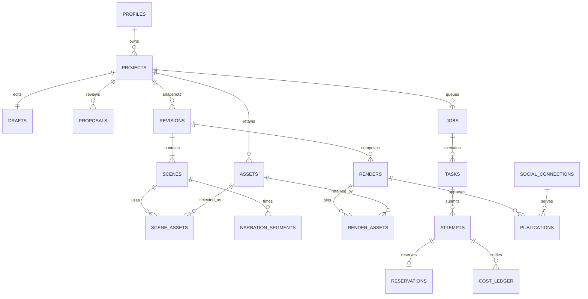

# Vydrivo — Database Design

Version: 1.1
Date: 26 October 2026
Status: Target design plus implemented Supabase persistence; see section 13
References: [PRD v1.4](PRD-V1.md), [Dashboard system design](DASHBOARD-SYSTEM-DESIGN.md), [Pipeline design](PIPELINE-TECHNICAL-DESIGN.md), [API design](API-DESIGN.md)

## 1. Scope, authority and implementation boundary

Use one PostgreSQL database (Supabase for the proposed hosted pilot), Supabase Auth
for identities, private object storage for media, and a database-backed job queue.
No Redis, message broker, vector database or payment ledger is required for V1.
Local JSON files remain prototype evidence, not a substitute for tenant-safe data.

This design supplies schema, constraints, transitions, concurrency and migration
contracts for later implementation. Tables/functions/indexes below are design
requirements, not installed objects. Do not provision a database or activate paid
services as part of this documentation task. UI design in Stitch follows these
contracts; implement only after that review.

V1 actual footage, 60–90-second product exports, immutable approved revisions,
caption-only edits, ₹0 initial service cap and conditional Instagram remain intact.
Internal cost accounting is not a customer credit balance. Graphics diagnostics
stay outside user project acceptance. V2 payments/teams/branding are not created now.

## 2. Conventions and schema boundaries

- `auth`: provider-managed identities; do not alter its password/token schema.
- `app`: owned domain tables, RLS, explicitly granted safe reads.
- `private`: worker credentials, tokens, accounting, idempotency, audit and queue
  internals; not exposed through browser-accessible generated database APIs.
- UUID primary keys generated server-side; scene stable IDs also UUIDs scoped to a
  project. UTC `timestamptz`, NOT NULL server `created_at`, `updated_at` on mutable
  rows; immutable rows have created_at only. All updates increment bigint version.
- All fields below are NOT NULL unless marked `?`. `?` means nullable, not an
  omitted relationship check. `id` UUID PK and created_at are implicit except for
  named composite/foreign primary keys. Mutable tables include updated_at/version
  unless stated otherwise. Operational queue versions/fences have separate meaning.
- State values use text + CHECK allowlists, allowing additive migrations without
  unreviewed enum changes. Every default is explicit: version=1, arrays empty,
  nullable pointers null, lifecycle as specified. No random fixture defaults.
- Bytes/samples/frame counters use bigint with nonnegative checks; duration in
  integer milliseconds for API, exact sample counts/rational rates for media.
  Canonical JSON hashes use SHA-256 bytea (32 bytes), hex at API boundary.
- Currency: uppercase ISO code; bigint micro-units (1 unit = 0.000001 currency unit),
  nonnegative amounts. APIs encode monetary bigint as strings. FX numeric(24,12),
  timestamped rate source plus conservative rounding. Never float/double money.
- Versioned JSONB holds a validated document only where structure varies. Relational
  columns own identity, relationships, authorization, ordering, status and money.
  Do not hide FK IDs solely in JSON. JSON Schema is enforced at service boundary;
  DB checks require object/array type, schema_version, size, known critical fields.
  Do not assume PostgreSQL has a built-in general JSON Schema validator.

Parent unique keys `(id,owner_id)` and `(id,project_id,owner_id)` exist where needed.
Children carry owner_id/project_id with composite FKs. This redundancy intentionally
prevents valid UUIDs from linking different tenants or projects. Foreign key columns
get deliberate indexes; PostgreSQL does not automatically index the referencing
side. Cross-row requirements use constraints/transactional procedures, not CHECK
queries into other tables. [PostgreSQL constraints](https://www.postgresql.org/docs/current/ddl-constraints.html).

## 3. Relationship map

Planning/cleanup jobs have nullable revision_id. Narration segments and scene asset
bindings are derived immutable outputs, not mutable edits to approved scene content.
Each render freezes exact bindings through its manifest and render_assets.

## 4. Identity, project, draft and planning tables

| Table | Columns and relationships | Constraints / lifecycle |
|---|---|---|
| `app.profiles` | `id` PK/FK auth.users(id), display_name text, timezone text, lifecycle, deletion_requested_at? | lifecycle active/deleting/deleted; name 1–80; timezone validated against IANA registry; no operator flag or password |
| `app.projects` | owner_id→profiles, title, original_input JSONB, lifecycle, next_revision_number bigint, next_generation_number bigint, latest_render_id?, deleted_at?, delete_requested_at? | active default; title 1–120; input topic+notes ≤10,000 chars; latest render same project/owner, accepted only via procedure; original_input immutable |
| `app.drafts` | project_id PK, owner_id, base_revision_id?, schema_version=1, selected_concept JSONB?, content JSONB, content_hash | exactly one per project; version CAS; 0–24 scenes while editing; incomplete fields allowed, no unknown schema |
| `app.proposals` | project_id,owner_id,job_id?,mode,base_draft_version,status,request_text,result JSONB?,change_summary?,requires_global_confirmation bool,applied_draft_version?,failure_code? | mode brainstorm/storyboard/revise/posting-caption; pending default; bounded request/result; proposal applies only to matching draft version |
| `app.conversation_messages` | project_id,owner_id,proposal_id?,role,text,sequence bigint | immutable; role user/assistant; allocate sequence under project row lock; unique(project_id,sequence); ≤2,000 input, ≤8,000 visible response; no hidden model reasoning |
| `app.revisions` | project_id,owner_id,number bigint,parent_revision_id?,source_draft_version,schema_version,content_hash,approved_at,approved_by→profiles | immutable approved snapshot only; unique(project_id,number) and unique(project_id,content_hash); approved_by=owner_id in V1; parent same project |
| `app.scenes` | id row PK, revision_id,project_id,owner_id,stable_scene_id UUID,position int,title,narration,estimated_duration_ms,visual_kind,visual_intent,visual_prompt?,reference_asset_id?,voice_preference,layout_type?,labels JSONB,events JSONB,caption_overrides JSONB,clip_selections JSONB | immutable; unique(revision_id,stable_scene_id), unique(revision_id,position); position 1–24; estimated_duration_ms 2,000–30,000; content limits follow API; footprint/FKs below |

A revision's storyboard is reconstructed from immutable scene rows plus revision
metadata; store canonical snapshot JSON only if required for reproducibility and
verify its hash against these rows on insert. Hash input includes title/order,
voice, captions, visual data and schema version, excludes DB timestamps/provider
runtime observations. Canonicalization version is pinned with schema_version;
Unicode normalization must not silently change approved text. Reusing the same
hash returns the existing approved revision; ordering uses monotonic number, not
wall clock. Explicit regeneration can create another job on the same revision.

`scenes.visual_kind` ai-generated-footage/motion-graphics; voice_preference male/
female; layout allowlist title/process/comparison. Layout capability availability
is separate from schema validity. Scene references and clip selections in JSON
must also populate `scene_input_assets(scene_id,asset_id,project_id,owner_id,role,
ordinal,in_ms?,out_ms?)` with composite FKs; unique(scene_id,role,ordinal).
This avoids unenforced JSON-only references. Reference assets must be validated
images; trim selections must be actual footage and fit measured duration. Reject
unsupported layout or provider input at approval/admission, not after billing.

Approval cross-row validation: 1–24 scenes, contiguous order, unique stable IDs,
total estimated 60,000–90,000 ms, footage share policy, complete narration/visual
intent, valid phrase occurrence events, all references retained/owned and approved.
Use one transaction to insert revision and every scene/reference; no partial snapshot.
Draft structural checks are intentionally weaker so autosave can preserve edits.

## 5. Media, timing and render tables

| Table | Columns | Constraints / behavior |
|---|---|---|
| `app.assets` | project_id,owner_id,kind,status,storage_backend,object_key,sha256?,bytes?,declared_bytes,mime?,native_properties JSONB?,provenance JSONB?,source_attempt_id?,expires_at?,validated_at?,rejected_reason?,deleted_at? | kind reference/footage/narration/thumbnail/export; pending default; unique(storage_backend,object_key); keys generated server-side; validated requires checksum/bytes/mime/properties |
| `private.upload_intents` | asset_id,project_id,owner_id,task_id?,expected_bytes,expected_sha256,declared_mime,reserved_bytes,expires_at,consumed_at?,status | issued/validating/completed/rejected/expired; unique(asset_id); never store signed URL as durable identifier |
| `app.scene_assets` | scene_id,revision_id,project_id,owner_id,asset_id,role,ordinal,in_sample?,out_sample?,timebase_rate?,binding_hash | immutable selection; unique(scene_id,role,ordinal,binding_hash); role footage/narration/reference/thumbnail; positive rate, out>in; same-project asset; bounds checked against validated media |
| `app.narration_segments` | scene_id,revision_id,project_id,owner_id,asset_id,narration_hash,voice_id,model_id,settings_hash,sample_rate,sample_count,alignment JSONB,alignment_hash | immutable; rate>0,count>0; approved text hash required; actual voice resolved server-side; reuse keyed by text+voice+model+settings |
| `app.caption_cues` | narration_segment_id,project_id,owner_id,cue_key,ordinal,start_sample,end_sample,text | immutable base cues; unique(segment,cue_key), unique(segment,ordinal); 0≤start<end≤segment samples; text 1–100 |
| `app.renders` | project_id,owner_id,revision_id,job_id,status,manifest JSONB,manifest_hash,renderer_version,output_asset_id?,duration_frames?,fps=30,width=1080,height=1920,validation_report JSONB?,accepted_at?,failure_code? | pending/accepted/rejected; accepted immutable; unique(job_id,manifest_hash); accepted duration_frames 1800–2700; output validated export, H.264/AAC checked |
| `app.render_assets` | render_id,asset_id,project_id,owner_id,role | composite PK(render_id,asset_id,role); pins all source assets including thumbnails if needed for history |

For one narration segment, prevent overlapping sample intervals using a GiST
exclusion constraint on `(narration_segment_id WITH =, int8range(start_sample,
end_sample,'[)') WITH &&)` if approved `btree_gist` extension is available. Otherwise
serialize inserts by locking the parent segment and checking neighbors in a
restricted procedure; no unprotected application-only precheck. Touching intervals
are allowed. Child end≤parent sample_count is a locked cross-row check, not an
invalid CHECK subquery. Cue corrections live in a new revision's caption_overrides;
never mutate base speech alignment to fit unrelated text.

Binding a clip multiple times is not permission to loop footage for duration.
Manifest validation rejects unapproved repeats/freezes, checks footage allocation
against every scene and uses measured sample boundaries converted cumulatively to
frames to avoid accumulating rounding drift. A provider may supply multiple clips
per scene. The prototype's one-clip-per-scene assumption is not imposed on this DB.

Accepted output validation checks complete narration, caption ranges/safe bounds,
60–90 seconds actual container duration, codecs, dimensions, coverage, native
quality disclosure and full decode. SQL numerical checks supplement media probing;
SQL cannot prove generated motion, licenses or visual correctness. Store evidence
and human review result. Known diagnostic mode is never an accepted product render.

Storage state: pending→validated/rejected; validated→expired/deleting;
rejected/expired→deleting; deleting→deleted. Add deleted explicitly to asset state
rather than deleting audit evidence prematurely. Expiry time alone revokes new
access even before cleanup changes status. Active pins prevent premature retention
cleanup; cannot pin already expired data. Asset content is immutable after validation.

## 6. Jobs, tasks, attempts and worker identity

| Table | Columns | Key rules |
|---|---|---|
| `private.workers` | label,credential_hash,scopes JSONB,capabilities JSONB,status,last_seen_at?,revoked_at? | active/revoked; high-entropy revocable credential hash only; no browser reads |
| `private.worker_grants` | worker_id,task_id,fencing_token,scope,expires_at,revoked_at? | unique(worker_id,task_id,fencing_token,scope); grants can't outlive lease |
| `app.jobs` | project_id,owner_id,revision_id?,proposal_id?,kind,state,waiting_reason?,retry_of_job_id?,generation_options JSONB,generation_sequence bigint?,progress_version,cancel_requested_at?,started_at?,finished_at?,failure_code? | kinds planning/generation/asset_validation/cleanup/publication; queued default; generation requires approved revision and unique(project_id,generation_sequence); publication binds through publication_tasks |
| `private.tasks` | job_id,project_id,owner_id,stage,logical_key,state,priority,eligible_at,lease_owner_id?,lease_until?,fencing_token bigint,heartbeat_at?,automatic_retry_count,waiting_reason?,result_refs JSONB?,cancel_requested_at? | unique(job_id,logical_key); queued default; count 0–2; all lease fields present together in leased state |
| `private.task_dependencies` | task_id,depends_on_task_id,job_id | composite PK; same-job FKs; task≠dependency; DAG validated on creation, immutable after dispatch |
| `private.attempts` | task_id,job_id,project_id,owner_id,provider,model,capability_version,logical_request_id,request_hash,state,provider_idempotency_key?,remote_id?,submission_permit_hash?,permit_expires_at?,submitted_at?,resolved_at?,safe_failure_code?,evidence_digest? | prepared default; unique logical_request_id; partial unique(provider,remote_id) where nonnull; no raw credentials/content logs |
| `private.attempt_observations` | attempt_id,source,event_key,observed_state,remote_id?,evidence_digest,received_at | append-only; unique(attempt_id,source,event_key); stale worker may record identity but cannot finalize outputs |
| `private.webhook_events` | provider,event_id,received_at,payload_digest,signature_verified,processed_at?,attempt_id? | unique(provider,event_id); no raw payload unless encrypted short-lived diagnostic retention approved |
| `private.queue_limits` | scope_key PK,max_queued,max_running,version | rows for global and each owner; locked for admission/claim; counters derived or maintained transactionally, periodically reconciled |

User-visible jobs and projections have RLS; internal task/attempt details are not
exposed directly. No database connection from an untrusted worker. Worker contract
uses scoped server endpoints, accepts only assigned jobs and checks lease/fence.
Queue table is the durable enqueue record, so a second queue transport/outbox is
unnecessary now. External side effects must still use attempt records. If email or
notifications are added, add a transactional outbox before coupling DB commits to
external delivery; do not put them in triggers.

### State transitions

| Entity | Allowed edges / terminal behavior |
|---|---|
| Project | active→deleting→deleted; no undelete endpoint in V1 |
| Proposal | pending→ready/failed; ready→applied/dismissed/stale; pending→dismissed allowed with job cancel; apply marks other old-base ready proposals stale |
| Job | queued→running/canceled/failed; running→retrying/succeeded/failed/canceled; retrying→running/failed/canceled; terminals immutable; explicit retry creates linked new job |
| Task | queued→leased/canceled; leased→waiting/succeeded/failed/canceled; waiting→queued/failed/canceled; recover expired lease according to attempt status before requeue |
| Attempt | prepared→submitting/canceled; submitting→accepted/uncertain/failed; accepted→pending/succeeded/failed/canceled; pending→succeeded/failed/canceled; uncertain→accepted/pending/succeeded/failed/canceled only through authoritative reconciliation |
| Render | pending→accepted/rejected; terminal rows immutable |
| Connection | disconnected→connecting→connected/reconnect_required/disconnected; connected→reconnect_required/disconnected; reconnect_required→connecting/disconnected |
| Publication | draft→planned (manual) or scheduled (API) on approval; planned→published(manual)/canceled; scheduled→preparing/canceled/failed; preparing→publishing/failed/canceled if no publish submitted; publishing→published/failed; uncertainty stays publishing + waiting_reason; cancellation intent does not imply canceled |

`unavailable` for connection is a capability projection, not a fake OAuth state.
Job waiting_reason does not invent additional lifecycle statuses. Lease expiry is
not provider failure. A remote request canceled authoritatively is different from
local cancellation intent. If an uncertain post is found published, record published
and inform user even if cancellation was requested; never claim successful cancel.
A canceled generation can receive reconciled cost/evidence without becoming success.

State transition enforcement: restricted DB procedures/trigger guard validates
old→new edge, expected version, required timestamps and related rows. Application
validation improves errors but is not the only barrier. Reject arbitrary state
updates by browser roles and worker callers. Terminal corrections use append-only
audit/reconciliation records, not rewriting accepted artifacts.

## 7. Budget, free entitlement and internal cost schema

| Table | Columns / purpose |
|---|---|
| `private.execution_policy` | singleton ID,paid_enabled default false,kill_switch default false,default_currency INR,version; only operator procedure changes |
| `private.free_entitlements` | service,model,account_ref,verified_at,expires_at,remaining_units,unit_kind,overage_disabled,evidence_ref; no entitlement inferred from API key presence |
| `private.budget_authorizations` | scope global/service/job,scope_ref,service?,currency,total_cap_micro,per_attempt_cap_micro,expires_at,approval_reference,approved_by_operator,approved_at,revoked_at?,version |
| `private.budget_accounts` | authorization_id PK,settled_gross_micro,confirmed_refund_micro,reserved_micro,version; lockable summary derived from ledger/reservations |
| `private.reservations` | attempt_id UNIQUE,service,currency,max_cost_micro,fx_snapshot JSONB,status,created_at,settled_at?; status held/settled/released; unknown outcome remains held |
| `private.reservation_scopes` | reservation_id,authorization_id,amount_micro; PK pair; same spend constrained by all scopes, not added twice as expense |
| `private.free_quota_holds` | attempt_id UNIQUE,entitlement_id,units,status; held/consumed/released; serialize remaining quota checks including other holds |
| `private.cost_ledger` | attempt_id,provider,event_kind,amount_micro,currency,provider_event_key,evidence_ref,related_entry_id?,occurred_at; immutable charge/refund/adjustment events |

All zero/free operations still need entitlement, quota, attempt and rate snapshots.
No budget authorization plus paid_enabled=false means zero paid submissions, not
unlimited free calls. An operator activation requires numeric cap, service,
currency, expiry and recorded explicit user authorization; code cannot self-approve.
Hosting bills are separately authorized and cannot be hard-capped by generation
ledger logic. Do not present budget alerts as guarantees against infrastructure
invoices.

Ledger amount≥0; event kind defines sign. Refund must reference an existing charge
in same currency/attempt, cumulative refunds cannot exceed it. Unique(provider,
provider_event_key,event_kind) via recorded provider column on ledger; each external
event posts once. Adjustments need operator evidence and audit. Hold lifetime is
not a fixed timeout: uncertain costs cannot be released solely due to age/cancel.

Atomic admissibility for each relevant account:
`settled_gross_micro - confirmed_refund_micro + reserved_micro + new_max_micro <= cap`.
Also enforce per-attempt and per-job cap, authorization validity and kill switch.
Use authorization-currency worst-case amount with FX/tax reserve; record provider
currency actuals separately. Reject unbounded maximum costs. Lock all applicable
accounts in deterministic order; no SUM-then-insert without locks. No free-tier
spillover to billing. If later actual provider charge exceeds reserved maximum,
record the truthful excess, freeze paid execution and alert; never hide the cost
or falsely claim external billing cannot diverge from estimates.

Release reservation only for authoritative no-charge evidence; settle with actual
charge and release unused remainder atomically. Refund is its own entry. Cost per
successful export counts all associated failed/abandoned attempts and shared
planning costs exactly once, not every download; allocate reused assets explicitly.
Zero successful exports gives undefined unit cost, not zero. No customer money
ledger or refund promise is implied by these V1 records.

## 8. Publication, OAuth, retention and operational records

| Table | Columns / constraints |
|---|---|
| `app.social_connections` | owner_id,provider instagram,remote_account_id?,account_label?,state,scopes JSONB,token_secret_id?,expires_at?,disconnected_at?; unique(owner_id,provider); remote account uniqueness across active owners decided conservatively: unique(provider,remote_account_id) when connected |
| `private.oauth_states` | owner_id,session_binding_hash,state_hash UNIQUE,pkce_secret_ref?,return_path,expires_at,consumed_at?; one-use locked consume; 10-minute validity; never raw code in logs |
| `private.secrets` | encrypted_ciphertext,nonce,key_version,purpose,owner_id?,expires_at?,revoked_at?; encryption key outside DB; no browser/worker direct SELECT |
| `app.publications` | owner_id,project_id,render_id,connection_id?,mode,state,caption,scheduled_for?,timezone,schedule_kind,approved_at?,approved_by?,approval_hash?,confirmation_source?,remote_media_id?,published_at?,waiting_reason?,cancel_requested_at? | manual/API rules below |
| `private.publication_tasks` | publication_id,task_id,phase,attempt_id?; unique(publication_id,phase,task_id); phases prepare/poll/publish/reconcile |
| `private.publication_attempts` | publication_id,logical_request_id UNIQUE,phase,state,remote_container_id?,remote_media_id?,request_hash,submitted_at?,evidence_digest?; external uncertainty rules same as generation |
| `private.media_delivery_grants` | publication_id,asset_id,token_hash,expires_at,revoked_at?; purpose-specific provider media retrieval, no general storage access |
| `private.idempotency_records` | actor_id,operation,key UUID,request_hash,status,response_code?,resource_refs JSONB?,expires_at; unique(actor_id,operation,key); no secret URL response snapshots |
| `private.audit_events` | actor_kind,actor_id?,action,owner_id?,project_id?,entity_type,entity_id?,request_id,metadata JSONB,occurred_at; append-only redacted events |
| `private.deletion_tombstones` | subject_type,subject_id,owner_hash?,requested_at,completed_at?,backup_expiry_at?; minimal replay suppression for restores, retention policy explicit |
| `private.rate_limit_windows` | key_hash,operation,window_start,count,expires_at; composite PK; bounded purge; no raw IP required |
| `private.project_storage_usage` | project_id PK,owner_id,retained_bytes,reserved_bytes,version; transactional admission counters reconciled with objects |

For publications: mode manual/instagram. Instagram approval requires active same-
owner connection and accepted retained render. Manual publication uses no connection,
remote ID or provider confirmation. `confirmation_source` manual/api/null; API
published requires remote_media_id and evidence; manual published requires explicit
manual action/timestamp. Unique(provider,remote_media_id) for nonnull API records,
where provider is fixed instagram or explicit constrained column. Caption, render,
schedule and timezone immutable after approval; edit by canceling unsent snapshot
and creating another. Approval hash includes all those fields. `scheduled_for`
required for approved plans; `now` resolves at approval using DB time.

Only allow schedule within tested retention: asset pinned through scheduled time
plus provider-processing grace, or reject before approval. Never extend unlimited
retention silently. Initially 30-day future horizon; missed automatic slot >15
minutes blocks for renewed approval. DST conversion takes place before storage,
with validated IANA zone and explicit instant; `timestamptz` alone does not preserve
user's intended zone. No rescheduling when profile timezone changes.

Publications intentionally do not cascade-delete an external post. Tombstoning a
project blocks unsent posts and reconciles in-flight ones before media cleanup.
Previously published external copies are outside project deletion; UI explains it.
A failed/rejected render cannot be published regardless of an asset's existence.

## 9. RLS, grants and foreign-key enforcement

Enable RLS on every app table, including join tables, cues and messages. No access
by anonymous role. Safe SELECT policy requires `owner_id=auth.uid()` plus active
profile/project, except owner-accessible cleanup job status/tombstone summaries.
Profiles use id=auth.uid(). Child policies cannot rely on client-provided project
IDs. Foreign-key integrity supplements RLS; RLS is not a replacement for FK checks.

Browser identity may read only approved safe columns/views. No direct INSERT/
UPDATE/DELETE on revisions, accounting, tasks, assets, publications or approvals.
Route mutations invoke narrow transaction functions with verified owner context.
Where SECURITY DEFINER is necessary: fixed safe search_path, explicit schema names,
revoke PUBLIC execute, least-privilege dedicated owner, validate session/owner and
all referenced IDs inside the function, forbid arbitrary SQL identifiers. For
server-only privileged functions, authenticate caller separately and supply owner
from verified auth, never from request JSON. Do not expose a service-role key.

Service roles/owners can bypass ordinary RLS; restrict their use, audit and test
with the actual deployed roles. Prefer user-scoped requests for safe reads. Workers
receive scoped grants through internal API; no unrestricted DB role. Enable FORCE
RLS where appropriate for app roles, but do not assume it constrains superusers or
BYPASSRLS roles. [PostgreSQL row security](https://www.postgresql.org/docs/current/ddl-rowsecurity.html).

Important FKs (all named, DEFERRABLE only if needed for transactional insertion):

- `(project_id,owner_id)` on every project child → projects(id,owner_id).
- `(revision_id,project_id,owner_id)` → revisions(id,project_id,owner_id).
- `(scene_id,revision_id,project_id,owner_id)` → scenes corresponding UNIQUE tuple.
- `(asset_id,project_id,owner_id)` → assets corresponding UNIQUE tuple.
- `(render_id,project_id,owner_id)` → renders corresponding UNIQUE tuple.
- Connection reference includes owner, never project ownership through a token row.
- Dependency edges include job_id on both ends; no cross-job graph edges.

Same-owner conditional references require FK **and** status check in transaction.
Reference-validation reads lock the parent asset to serialize concurrent deletion.
Never use broad ON DELETE CASCADE from auth.users into accounting or active media.
Use RESTRICT for durable references; controlled cleanup removes children in explicit
order. Drafts and strictly ephemeral join rows may cascade only inside approved
purge after retention/reconciliation. Composite key columns all nonnull except
explicit optional FK as a whole; avoid partially null composite references.

## 10. Transaction recipes and lock order

Default READ COMMITTED plus explicit row locks/CAS and unique constraints is adequate
for these bounded operations. Retry deadlocks/serialization failures at most twice
with jitter, rerunning whole pure DB transaction; never retry an external submission
as a database retry. If a future invariant needs SERIALIZABLE, test abort/retry
behavior rather than assuming stronger isolation eliminates retries.
[PostgreSQL isolation](https://www.postgresql.org/docs/current/transaction-iso.html).

Lock order for multi-domain mutations: global queue/policy row if needed → owner
quota row → project → draft → revision/assets in UUID order → job → task → attempt
→ budget account UUID order → reservation/publication. Claims operate on queue
and task rows only, then verify project cancellation before any new external intent.
Operations acquiring a subset maintain the same order; avoid holding task then
project when another path locks project then task. Keep transactions short.

### T1 Create and autosave

Create: verify profile, insert project+draft v1 and idempotency result atomically.
Save: lock active project, `UPDATE drafts … WHERE project_id=:id AND version=:expected`;
zero rows →409, never insert on conflict overwrite. Validate draft structure, set
hash/version+1 and touch project.updated_at in same transaction. Job progress must
not increment draft.version. Approval uses saved content, not a UI text buffer.

### T2 Proposal apply and revision approval

Apply: lock project/draft/proposal, compare base version/status, require explicit
global-change confirmation if flagged, store new draft/hash and applied proposal
in one commit. Other stale-base proposals remain visible but cannot apply silently.
Approval: lock project/draft, strong validation, allocate revision number from
project.next_revision_number, insert immutable revision/scenes/references, audit.
Deduplicate same hash. No enqueue required to make approval recoverable. No network.

### T3 Generation admission and retry

Lock queue limits/global and owner, project and approved revision. Check unexpired
capability/free access or valid paid policy, queue/storage admission, request hash.
Allocate project.next_generation_number for generation jobs, then insert job/task
DAG + idempotency result once. Generation job limit counted from
queued/running/retrying states, not browser open tabs. Provider reservations occur
immediately before each submission, not only at admission. Manual retry creates a
new job linked to failed old job, reuses validated assets, rechecks limits; unknown
outcome is not retryable. Caption-only changes produce composition/render tasks,
not footage/TTS calls. Regenerate intent has a unique nonce to bypass content cache.

### T4 Claim, heartbeat and fencing

In a short transaction, lock quota row then claim eligible ready tasks using
`FOR UPDATE SKIP LOCKED`, verify all dependencies succeeded and concurrency slot,
set leased, worker, lease_until=DB now+90s and increment fencing_token. Heartbeat
~15s updates only matching active worker/token/unexpired lease. Return no task if
none eligible. Do not hold row locks during rendering or network waits.

Expired task lease: inspect existing attempt. No external intent → safely requeue.
Accepted/pending → schedule reconciliation poll. Submitting/uncertain → waiting
uncertain_submission. New worker never assumes expired lease means no request.
Completion must match live fence, noncanceled job and valid project; stale result
can be quarantined/reconciled but cannot become current output.

### T5 Reserve, submit and reconcile

Lock policy/owner/project/task/attempt and all applicable budget rows in stated
order; verify active authorization, kill switch and quote version; insert held
reservation or free quota hold and prepared attempt atomically. Server issues
single-use short-lived submission permit. Immediately before remote submit,
transition prepared→submitting, record intent and recheck permit/policy. Commit,
then call provider once; persist remote ID immediately in another transaction.
No SQL transaction spans the network. A tiny boundary after final check cannot
undo an already in-flight request; revocation stops new permits/submissions.

HTTP timeout/crash without proven rejection →uncertain, retain hold. Poll by known
remote ID/provider idempotency key; append observations. Only authoritative evidence
settles, fails or releases. Operator resolution needs evidence and audited identity.
Do not infer a refund from a failed or locally canceled render.

### T6 Complete media/render

Upload quarantine object with generated key → verify bytes/hash/media → insert
validated asset evidence. Render into temporary object, probe/full-decode, then
lock project/job/task, validate fence, insert accepted render and all render_assets
pins, update job/task state and latest render pointer atomically. Latest pointer
moves only to equal/newer revision number; for the same revision use generation
sequence allocated under project lock at enqueue to prevent late older jobs replacing newer results.
Object storage and DB are not one transaction: a crash leaves an orphan object
for reconciliation, never a success row for a missing object. A post-commit missing
object is an incident; block access, preserve audit, recover from backup.

### T7 Publication and deletion

Approve post: lock owner/project/render/assets/connection/publication in fixed
order, validate capabilities + retention, freeze snapshot and queue publish task
once. External prepare/publish have separate durable intents and reconciliation.
Publishing timeout retains state+uncertainty, no automatic duplicate post.
Delete: lock project, mark deleting and tombstone, request job cancellation,
cancel unsent posts, enqueue cleanup, revoke new access grants in same transaction.
Reconcile in-flight posts/attempts before deleting needed objects. Purge media,
then dependent metadata according to retention. Do not turn unresolved expenses
into zero by deleting rows. Cleanup status remains owner-readable even though the
project is unavailable through normal queries.

## 11. Index plan tied to queries

Create PK/unique indexes specified above first. Additional B-tree indexes below
are initial candidates, validated with EXPLAIN (ANALYZE, BUFFERS) against realistic
fixtures before deployment. Include filter prefixes and stable cursor tie-breakers.

| Index | Query/use |
|---|---|
| projects(owner_id,updated_at DESC,id DESC) WHERE lifecycle='active' | Dashboard and project pagination |
| revisions(project_id,created_at DESC,id DESC) | Revision history |
| proposals(project_id,created_at DESC,id DESC) | Conversation proposals |
| conversation_messages(project_id,sequence DESC) | Bounded thread history; API cursor uses sequence |
| assets(owner_id,created_at DESC,id DESC) and assets(project_id,kind,created_at DESC,id DESC) | Owner library and project/type filter |
| assets(expires_at,id) WHERE status='validated' | Retention sweep; recheck pins before expiry |
| jobs(owner_id,created_at DESC,id DESC), jobs(project_id,created_at DESC,id DESC) | Lists/status |
| jobs(owner_id,state) WHERE state IN ('queued','running','retrying') | Concurrency admission |
| tasks(priority DESC,eligible_at,id) WHERE state='queued' | Ready task claim |
| tasks(lease_until,id) WHERE state='leased' | Expired lease recovery |
| tasks(eligible_at,id) WHERE state='waiting' | Poll/reconcile scheduler |
| task_dependencies(depends_on_task_id,task_id) | Unblock successors |
| attempts(task_id,created_at DESC), attempts(state,created_at) WHERE state IN ('submitting','uncertain','pending') | Reconcile and history |
| renders(project_id,created_at DESC,id DESC) | Preview/export history |
| publications(owner_id,scheduled_for,id), publications(scheduled_for,id) WHERE state='scheduled' | Calendar and due work |
| reservations(status,created_at) WHERE status='held' | Unresolved budget audit, not automatic expiry |
| cost_ledger(attempt_id,occurred_at,id) | Settlement and unit cost |
| idempotency_records(expires_at), oauth_states(expires_at), upload_intents(expires_at) | Bounded cleanup |
| audit_events(project_id,occurred_at DESC,id DESC) | Support audit; no prompt search |

Add indexes on otherwise uncovered FK columns (scene bindings, render_assets.asset_id,
publication.render_id, retry_of_job_id, asset source attempt) needed for deletion
and lookup. Do not add an index to every JSONB field or text column. Title-only
substring search initially scans bounded owner data; add approved pg_trgm GIN only
when measured need justifies it. JSON search/vector embeddings not V1 requirements.
Do not put `now()` in partial-index predicates; index status/expiry columns and
compare current time at query execution. Concurrent index creation later requires
its own migration step outside a transaction; check invalid indexes after failure.

## 12. Retention, backup and migration sequence

Operational proposal: temp objects within 24h after no active lease references;
export/dependent media 30 days with notice, pinned only for approved scheduled
publication within horizon. Orphan cleanup uses inventory+DB reference checks and
age grace; never delete an object solely because one list call missed it. Object
checksums verified during backup/restore. Database backup alone cannot restore MP4s.

Pilot RPO≤24h, RTO one staffed working day remain targets, not measured guarantees.
Before external invitations settle backup retention/expiry and perform a restore.
If free capacity cannot meet them, use disposable test data or block external pilot.
Restore tombstones before enabling workers/read access; do not resubmit restored
uncertain jobs or revive scheduled/deleted posts automatically. Secrets separately
encrypted with recoverable versioned keys. Never commit database dumps or keys.

Migration plan (files to be written only in implementation):

1. Identity/profile, project/draft, ownership keys/RLS and grants; test two tenants.
2. Revision/scene/input reference/proposal/message schema and immutable snapshot procedures.
3. Asset/upload/timing/caption/render schema; storage quarantine and retention constraints.
4. Queue/tasks/dependencies/attempts/fences/idempotency/limits; crash recovery tests.
5. Entitlement/budget/reservations/ledger and kill switch; concurrent reservation tests.
6. Manual publication/calendar; conditional OAuth/private tokens and API publication.
7. Audit/deletion/restore operations, query indexes and privacy verification.

Install only supported approved extensions; choose the locked-parent alternative
for interval overlap if btree_gist unavailable. Use expand/backfill/validate/contract
migrations; readers accept old/new schemas before writes switch. Backfill in batches,
verify hashes/FKs, add NOT VALID constraints where supported then validate. Never
rewrite approved snapshots in place to change schema: retain decoder version or
create explicit derived migration records. Schema/type and row-policy changes are
reviewed together. Destructive changes require backup and separate authorization.
Down migration cannot recover deleted media; rollback code only against compatible
schema. Contract migrations must not be hidden in app startup.

Prototype import: trusted operator-only, map old scene IDs to UUIDs, preserve
original JSON/checksums/provenance, mark fixture origin and rights. Do not import
synthetic/graphics diagnostics as accepted footage product renders, infer missing
provider IDs or fabricate voice entitlement. Missing alignment/raw timestamps
remain missing evidence; historical phrase captions do not become word timestamps.

## 13. Verification matrix and UI implications

| Scenario | Required invariant |
|---|---|
| Cross-tenant project/scene/asset/render/connection references | RLS + composite FK/procedure reject, no existence leak |
| Concurrent draft saves / approvals | Exactly one CAS winner; snapshot matches saved hash |
| Duplicate enqueue and key with changed body | One durable result; conflict on changed payload |
| Caption edit / prompt edit / reorder / regeneration | Minimal invalidation; immutable old render/bindings retained |
| Competing budget reservations and refunds | No cap oversubscription/double settlement/refund; unknown holds retained |
| Worker crash before/after remote submission | Recovery never blindly generates twice; stale fence cannot commit |
| Duplicate/out-of-order callback and expired credential | Idempotent observation, terminal state/ownership preserved |
| Late completion of an older revision | Does not replace current newer preview |
| Upload finalize race / unsafe media / storage-full | Reserved bytes respected; invalid asset never validated |
| Overlap/negative/out-of-bounds caption/trim | DB/procedure rejects; renderer never accepts invalid timeline |
| Delete racing with generation/publish | New side effects blocked, uncertain outcomes reconciled |
| DST, reconnect, missed schedule, expired media | Explicit waiting/error/manual fallback; no silent wrong-time post |
| Restore and cleanup | Tombstones re-applied; objects/rows match; no auto-replay of remote work |

Test transactions with two actual DB connections, not only mocked repositories.
Use deployed roles for RLS checks, test service-role limitations separately, and
fault-inject at every intent/commit/object boundary. Validate query plans at pilot
scale and document cold vs warm latency. No live provider tests run by default.

Stitch needs states derived from data, not placeholder success: draft version
conflict, proposal pending/stale, capability disabled, worker offline, uncertain
submission, old render/new draft, media expired, publication cancel pending,
manual-vs-API confirmation and deletion in progress. It must not expose internal
cost ledger, worker tokens, object keys or a customer billing page in V1.

## 14. Completion and deferred schema

This document covers the logical V1 tables, constraints, relationship checks,
state machines, transactions, indexes, authorization, retention and migration plan.
Implementation must verify them with migrations and integration tests; writing the
design does not prove database correctness. External gates remain provider access,
voice rights, cloud approval, tested backups and official Meta eligibility.

V2 candidates: payment orders/events, customer credit reservation/ledger/refunds,
subscription allocations, branding and multiple providers. Future teams need a
workspace membership model and a deliberate RLS migration; do not repurpose a
user-supplied owner_id. None are silently enabled by this schema. Next step:
review UI flows in Google Stitch using this document and the API contracts.

## 13. Implemented Supabase persistence delta — Feature 1 (26 October 2026)

The implemented application uses Supabase Auth and the `public.projects` table from
`supabase/migrations/0001_projects.sql`. This differs from the target multi-table
`app.*` design above; the target remains a future contract, not a claim that those
tables exist.

`supabase/migrations/0002_project_idea.sql` adds the Idea-step fields:

| Column | Type | Rule |
|---|---|---|
| `audience` | `text not null default ''` | at most 500 characters |
| `notes` | `text not null default ''` | at most 20,000 characters; line breaks allowed |
| `voice_preset` | `text not null default 'daniel-test'` | 1–60 characters; API allowlist also validates |

The migration is additive. Existing `owner_id`, RLS policies, timestamp trigger,
`storyboard` JSONB, approval fields and status remain unchanged. No auth tables,
MongoDB collections or new storage buckets are introduced.

The API selects and maps `audience`, `notes` and `voice_preset` alongside the
existing project fields. `voice_preset` stores the user's selection only; it does
not prove ElevenLabs access, synthesis, preview availability or commercial rights.
Storyboard approval remains hash-bound to the exact storyboard JSON and is reset by
edits. Idea suggestions are not persisted; only the selected idea is saved.

Optimistic concurrency uses the existing `updated_at` column as the version token;
no migration is required. The `projects_touch_updated_at` trigger advances it on
every write. Conditional PATCH/PUT statements filter on
`updated_at = <client version>` and return the new row, so a stale write matches no
row and is reported as `PROJECT_CONFLICT` with the current server row. Ownership,
RLS and approval fields remain server-controlled.

Storyboard revision history (a separate immutable revision table), two-account RLS
evidence, durable rate limits and media storage remain future features.

## 14. Saved idea directions — 5 November 2026

`supabase/migrations/0003_project_idea_suggestions.sql` adds one optional table:

| Column | Type | Rule |
|---|---|---|
| `project_id` | `uuid primary key` | references `public.projects(id)` on delete cascade |
| `owner_id` | `uuid not null default auth.uid()` | references `auth.users(id)` on delete cascade |
| `suggestions` | `jsonb not null` | must be a JSON array; API caps at 5 validated suggestions |
| `source_topic` | `text not null default ''` | at most 2,000 characters |
| `created_at` / `updated_at` | `timestamptz not null default now()` | `updated_at` advanced by the existing touch trigger |

RLS is enabled with authenticated-only select/insert/update/delete policies. The
insert and update policies also require the referenced project to belong to the
caller, so a guessed project UUID cannot create a row for another owner.

The table is deliberately separate from `projects`. Saving directions does not
advance the project's `updated_at`, so it cannot invalidate an open Idea editor's
optimistic version token. The table is optional: if the migration is not applied,
the API reports the store as unavailable and the client uses its seven-day browser
cache. Cross-device behavior is only active after the migration is applied.

The migration is additive and does not modify auth tables, existing projects,
storyboards or approval fields.

## 15. Request safety — 5 November 2026

`supabase/migrations/0004_request_safety.sql` adds two optional tables and one
function:

| Object | Purpose |
|---|---|
| `request_idempotency` | `key` (server-derived hash), `owner_id`, `scope`, `request_hash`, `status`, `response_status`, `response_body`, `expires_at`; primary key on `key` |
| `request_rate_limits` | `(owner_id, bucket, window_start)` primary key with an integer `count` |
| `consume_request_rate_limit(p_bucket, p_limit, p_window_seconds)` | Atomic upsert/increment returning `{allowed,count,limit,remaining,resetAt}` |

Both tables have owner-only RLS. The function runs with invoker rights, uses
`auth.uid()` and requires the caller's own rows, so the authenticated user cannot
consume another user's quota. Idempotency keys are stored as hashes; the raw client
key is never persisted. The 24-hour `expires_at` is checked on replay: an expired
row is treated as a new request and is overwritten on completion. Automatic
deletion of expired rows is a later operational task.

Until the migration is applied, the API reports the stores as unavailable and
fails open to the existing in-memory dedupe and no durable limit. Generation does
not depend on either table.

## 16. Two-account RLS isolation test — 5 November 2026

`supabase/tests/rls_isolation.sql` is the release check for owner isolation. It
creates two temporary `auth.users` and one `public.projects` row per owner inside
a transaction, switches the authenticated role and `request.jwt.claims` to each
owner, and asserts:

- Owner A sees exactly one project and cannot see Owner B's row.
- Owner A's update/delete of Owner B's row affects zero rows.
- Owner A cannot insert a project with Owner B as `owner_id` (RLS error).
- Owner B sees exactly one project and cannot see or modify Owner A's row.
- The anon role cannot read `public.projects`.
- `RLS isolation passed` is returned before the transaction is rolled back.

The test is additive and temporary: `rollback` removes the users and projects. It
is not run automatically because the repository has no service-role key or second
account. Run the whole script in the Supabase SQL editor; if an assertion fails,
run `rollback;` manually and record the failed check.

`prototype/rls-isolation.mjs` (`npm run test:rls`) is the API-level alternative.
It requires `SUPABASE_SERVICE_ROLE_KEY` in `.env.local`, creates two temporary
confirmed users through the Admin API, signs them in with the publishable key,
runs the same owner A/B checks through PostgREST, and deletes the users afterward.
The service-role key is used only server-side and is never printed.

## 17. Private media assets — 6 November 2026

`supabase/migrations/0005_media_assets.sql` adds the first media metadata table.
It was applied in the Supabase SQL editor on 6 November 2026 (`Success. No rows
returned`).

| Column | Contract |
|---|---|
| `id` | `uuid primary key default gen_random_uuid()` |
| `owner_id` | `uuid not null default auth.uid()` → `auth.users(id)` on delete cascade |
| `project_id` | `uuid not null` → `public.projects(id)` on delete cascade |
| `kind` | `reference` or `thumbnail` |
| `status` | `pending`, `validated`, `rejected`, `deleted` or `expired`; new rows are `pending` |
| `storage_backend` | `s3` or `r2`; current rows use `s3` |
| `object_key` | unique server-generated key under `users/<owner>/projects/<project>/<kind>/` |
| `filename` | display-only original name, sanitized to 1–120 characters |
| `declared_bytes` | requested size, 1 byte–100 MB |
| `bytes` | checked object size after finalize |
| `mime` | `video/mp4`, `video/webm`, `image/jpeg` or `image/png` |
| `sha256` | optional checksum; not populated by the current HEAD/magic-byte slice |
| `rejected_reason` | bounded reason for a failed finalize |
| `created_at` / `validated_at` / `expires_at` / `deleted_at` | lifecycle timestamps; pending intents expire after one hour |

RLS is enabled with owner-only select/insert/update/delete policies. The insert
policy also requires the referenced project to belong to the caller. The API
uses the signed-in user's access token; the service role is never sent to the
browser.

Two security-invoker functions enforce quota and read usage:

- `reserve_media_asset(p_project_id, p_kind, p_object_key, p_mime, p_bytes,
  p_limit, p_filename)` takes an owner advisory lock, sums active `pending` and
  `validated` declared bytes, rejects an over-limit request, and inserts the
  pending row atomically. The key must start with the caller's owner/project/kind
  prefix.
- `media_quota_usage(p_limit)` returns `{usedBytes, limitBytes, remainingBytes}`
  for the caller.

The current per-owner quota is 500 MB. Pending rows count until they expire;
`rejected`, `deleted` and expired rows do not count. Finalize is a conditional
update from `pending` to `validated`; the API first checks the object with S3 HEAD
(size and content type) and reads the first bytes to verify the PNG/JPEG/MP4/WebM
signature. A mismatch deletes the object, marks the row `rejected` and frees the
quota. Deleting an active asset deletes the object first, then marks the row
`deleted`. Deleting a project cascades metadata and the API best-effort deletes
the project's active objects.

This slice does not yet store native dimensions/duration, run a full decode or
probe, bind a validated asset to a scene/revision, sweep expired rows, or expose
the `/app/library` page. `sha256` and `scene_assets` remain future work. Generated
footage and exports stay worker-only; user uploads are limited to references and
thumbnails. The private bucket must have no public development URL or custom
domain.

## 18. Media probe + scene references — 7 November 2026

`supabase/migrations/0006_media_probe.sql` adds two nullable columns to
`public.media_assets`:

| Column | Contract |
|---|---|
| `native_properties` | `jsonb` object; normalized `ffprobe` output after a successful finalize |
| `probe_error` | bounded text reason for a rejected probe; never contains credentials or signed URLs |

The normalized object currently stores `kind` (`image`/`video`), `width`,
`height`, `durationMs` (null for images), `videoCodec`, `audioCodec`, `hasAudio`,
`frameRate`, `format`, `fullDecode: true` and `probedAt`. A check constraint
requires `native_properties` to be an object or null and `probe_error` to be at
most 500 characters.

Finalize now downloads the object to a server temp file, runs `ffprobe` and a
full `ffmpeg` decode, then writes `native_properties` in the same conditional
`pending → validated` update. Probe/decode failures delete the object, mark the
row `rejected`, record a bounded `rejected_reason` and `probe_error` code, and
release quota. A missing server binary is retryable and does not reject the row.
The range read uses the HEAD `ETag` as `If-Match`; the committed copy uses
`CopySourceIfMatch`, and the committed download uses the copy `ETag` as
`If-Match`. A changed object returns `MEDIA_OBJECT_CHANGED`, and the downloaded
byte count is re-checked.
The temp file is removed in a `finally` block. The server resolves
`ffprobe`/`ffmpeg` from `process.cwd()` (or `FFPROBE_PATH`/`FFMPEG_PATH`) because
Turbopack rewrites the package-provided `__dirname` to `/ROOT`.

Project deletion lists active and rejected object keys in 500-row pages (pilot
cap 100,000) so cleanup is not capped at 200 objects. A background cleanup job
should eventually remove the cap and handle storage failures.

Finalize now copies the validated object to a fresh committed key, downloads the
committed copy with the copy `ETag` as `If-Match`, updates
`media_assets.object_key`, deletes the original upload key and serves only the
committed key. A probe/download/finalize failure deletes the committed copy so a
rejected attempt leaves no orphan. The validated asset no longer points at the presigned PUT key, so
a post-finalize overwrite of the validated object is closed. A client can still
re-upload to the deleted original key until the URL expires, creating an orphan;
a lifecycle rule or one-time upload grant remains future work.

`supabase/migrations/0007_media_rpc.sql` revokes direct insert/update/delete on
`media_assets` from `authenticated`; only owner-scoped SELECT remains. Reserve,
finalize, reject and delete are owner-checked security-definer RPCs. They enforce
project ownership, key prefix, declared bytes/MIME and the pending/validated
transition, so direct table PATCHes can no longer mark an asset validated or
change its key. The RPCs are still executable by an authenticated owner and
cannot prove the S3 object exists; the API remains the trust boundary for
HEAD/probe validation. A server-only capability or secret is future hardening.

Scene references are stored in the existing
`public.projects.storyboard.scenes[].referenceAssetId` JSON, not in a normalized
`scene_assets` table yet. The server accepts only a UUID that resolves to a
`validated`, `reference`-kind `media_assets` row in the same project. A present
reference is included in the storyboard review hash; boards without references
keep the previous hash shape. Deleting an asset does not rewrite existing
storyboards, so the UI surfaces a missing-reference warning and lets the user
clear or replace it.

No database FK enforces the JSON reference yet. `scene_assets`, asset-native
properties in generation manifests, retention and cross-project reference
validation at the DB level remain future work.

## Graphics render jobs (8 November 2026)

Free graphics render jobs still write local `job.json`, `status.json`,
`data.json`, `report.json` and `output.mp4` under
`prototype/output/graphics-jobs/<runId>/` while rendering, with a per-project
lock under `locks/` and a latest-run pointer. When a render completes, the
authenticated status poll copies the MP4, thumbnail, exact render script and
metadata to private storage and upserts `public.video_renders`. The table stores
owner/project/run IDs, title, language, voice, duration, dimensions, object keys,
bytes and metadata; the unique key is `(owner_id, run_id)`. Local files remain a
fallback for development and for runs that have not been backfilled. Retention
and cleanup of local files remain pending.

### public.video_renders

| Column | Type | Notes |
| --- | --- | --- |
| `id` | `uuid primary key` | `gen_random_uuid()` |
| `owner_id` | `uuid not null` | defaults to `auth.uid()`, cascades from `auth.users` |
| `project_id` | `uuid not null` | references `public.projects(id)` on delete cascade |
| `run_id` | `uuid not null` | graphics job id; unique with `owner_id` |
| `title`, `language`, `voice` | text | render display metadata; language/voice are constrained |
| `status` | text | `uploading`, `ready` or `failed` |
| `seconds`, `width`, `height` | numeric/int | validated duration and dimensions |
| `video_key`, `thumbnail_key`, `script_key`, `metadata_key` | text | private object keys; `video_key` required |
| `bytes`, `thumbnail_bytes`, `script_bytes` | bigint | stored object sizes |
| `metadata` | jsonb | language/voice/duration/render metadata |
| `created_at`, `updated_at` | timestamptz | creation and trigger-maintained update time |

RLS allows authenticated owners to select/insert/update/delete only their own
rows; insert/update also require an owned `project_id`. The browser never gets
storage credentials or direct table access beyond the authenticated API.

### public.project_graphics_scripts

| Column | Type | Notes |
| --- | --- | --- |
| `project_id` | `uuid primary key` | references `public.projects(id)` on delete cascade |
| `owner_id` | `uuid not null` | defaults to `auth.uid()` |
| `script` | `jsonb not null` | validated scene text, max 512 KB |
| `updated_at` | `timestamptz` | trigger-maintained |

RLS is owner-scoped with the same project-ownership check on insert/update.

## Videos library (8 November 2026)

The Videos library reads owner-scoped rows from `public.video_renders` and merges
any local completed non-test jobs that are not yet durable. The API filters by
owner, `status.state = done`, `testMode !== true` and a positive duration; the
thumbnail/file routes re-check project and owner before signing a private URL.
`video_renders` stores no public URL and no object bytes. The local filesystem
remains the fallback when the table or storage is unavailable. Job retention and
cleanup remain pending.

## Scene text scripts (8 November 2026)

The scene text editor stores the validated script in
`public.project_graphics_scripts` as owner-scoped JSON, keyed by `project_id`,
with a local mirror at `prototype/output/graphics-scripts/<projectId>.json`. The
API re-checks project ownership and approval, validates scene IDs/count against
the approved storyboard, and the render job receives a normalized copy. The
table's insert/update policies also require project ownership. If the table is
unavailable, the route falls back to the local script and returns
`durable:false`. Production deletion cleanup for the local mirror remains
pending.

## Video backups (7 November 2026)

`POST /api/v1/videos/backup` writes a timestamped local backup directory under
`~/Vydrivo-Backups/` and does not add a Postgres table. The manifest lists only the
owner's completed non-test runs. This is a local safety copy; durable production
storage is provided separately by `video_renders` plus private object storage.
