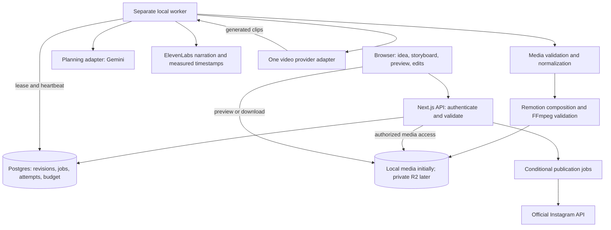

# Vydrivo V1 — Pipeline Technical Design & Prototype Plan

Version: 1.1  
Date: 19 October 2026  
Status: Local prototype partially implemented; automated full workflow unverified  
Source of truth: [PRD-V1.md](PRD-V1.md), version 1.3  
Initial incremental service-spend ceiling: **₹0**

## 1. Purpose and fixed decisions

Translate the PRD into an implementable pipeline and a sequence of evidence-producing experiments. This document does not replace the PRD or authorize installs, accounts, paid requests, cloud resources, deployment or publication. Prototype evidence and remaining gaps are recorded in the implementation reconciliation below.

- V1 generates actual moving footage through one video provider, combines it with narration and captions, supports scene revisions, and exports MP4. Images, pan/zoom effects and template animations cannot satisfy footage acceptance.
- User videos are 60–90 seconds with AI-selected length and conversational revisions; no duration selector. Five-second and 30-second outputs are internal fixtures only.
- Default scene planning uses generated footage. Supplementary graphics must be explicit in the approved storyboard. The full-duration feasibility fixture must demonstrate footage coverage across the video, not a token clip embedded in an otherwise template-only demo.
- English narration first. Image-to-video is conditional on provider support and upload tests. Perfect subject continuity is not promised.
- Local development, narration, composition and media storage first. Approved hosting later: Amplify web app, private R2 media, Supabase auth/Postgres, supervised local worker. EC2 only when continuous operation is justified.
- Free Wan/ZeroGPU access is a candidate experiment, not a confirmed working integration. If unavailable, preserve the ₹0 ceiling. Luma is a paid fallback candidate only after explicit numeric budget approval; never switch automatically.
- No customer billing in V1. Official Instagram access and successful tests gate live publishing; manual export remains available.

## 2. Architecture and trust boundaries

The diagram shows logical responsibilities. During a local experiment the worker may access a local database directly. In a hosted pilot, the laptop uses outbound authenticated worker endpoints with short-lived/scoped job access; it does not expose inbound ports or receive a shared unrestricted database service key. Browser code receives neither provider keys nor worker privileges. Browser media access is through an ownership-checking local handler initially and short-lived signed URLs later, not direct filesystem access.

| Component | Responsibility | Must not do |
|---|---|---|
| Web app | Review, edit, approve, enqueue, show status, preview/download | Run long renders in a request or trust client budget/ownership claims |
| Planning adapter | Produce validated structured scene proposals | Execute model-produced code or change approved narration silently |
| Worker/orchestrator | Resolve dependencies, lease tasks, reconcile attempts, write manifests | Submit an uncertain provider request again blindly |
| Video adapter | Capabilities, estimate, submit, status, cancel if supported, retrieve result | Hide provider restrictions or silently route to another model |
| Narration adapter | Synthesize approved phrases, record voice/version, measure audio | Claim word alignment from character counts |
| Media layer | Verify/decode/normalize permitted media with resource limits | Fetch arbitrary URLs or execute embedded instructions |
| Renderer | Compose validated local assets into output | Contact external services from unrestricted scene code |
| Storage adapter | Put, read, checksum, authorize access, delete | Treat S3 and R2 as identical for every operation |
| Publication worker | Publish an approved immutable snapshot | Publish automatically after generation or rewrite a scheduled revision |

Suggested future module boundaries: web, orchestration, contracts, planning, video-provider, narration, media, renderer, storage, publishing. These are design boundaries, not a request to create a monorepo or microservices. Start with one repository and one worker process.

## 3. Prototype persistence versus product persistence

M0a is a single-owner local experiment, without accounts or a dashboard. Save a versioned manifest and evidence locally; use atomic file replacement and checksums. It cannot claim multi-user durability or production recovery.

M0b exercises provider submission and reconciliation with a local durable attempt journal. Before M2 concurrency/recovery acceptance, move orchestration records into Postgres and test transactional claims/reservations. Prefer an existing compatible local Postgres if available; selecting/installing a runtime is part of future authorized setup. Do not run a large multi-container stack on the 8 GB Mac merely to render one scene. The local journal is never a substitute for the V1 transactional queue.

| Entity/record | Required fields and invariants |
|---|---|
| Project | ID, owner, original input, title, current draft, latest successful render, deletion state |
| Revision | Immutable ID, parent, versioned scene specification, input hash, approval timestamp, approver; draft saves use optimistic version checks |
| Scene | Stable ID, order, narration, visual intent, asset kind, prompts, optional reference, expected duration and selected clip versions |
| Asset | Owner/project, kind, storage key, checksum, bytes, source duration/resolution/fps, provenance, validation state, retention deadline |
| Narration segment | Scene/revision, approved text, voice/version, checksum, sample count/rate, measured start/end |
| Generation attempt | Logical request ID, provider/model/version, canonical request hash, idempotency key, remote ID if known, state, sanitized error, estimate/actual cost |
| Job/task | Revision, stage, dependencies, lease owner/token/expiry, attempts, next retry, cancellation flag, outputs |
| Budget/reservation | Authorization ID, currency, expiry, total/per-job cap, reserved/settled amounts, attempt linkage, price snapshot |
| Render | Immutable manifest hash, source revisions/assets, technical properties, validation report and output key |
| Publication | Approved render/caption hash, timezone/schedule, connection, remote ID and reconciliation state |

Never use mutable signed URLs as asset identities. Store provider URLs only as restricted temporary retrieval metadata. Every job belongs to an immutable revision; a later edit cannot change an in-flight job's inputs.

## 4. Internal contracts

These are data/API design requirements, not implementation code or provider endpoint claims.

### Scene and render manifest

A validated scene specification includes schema version, stable scene ID, narration text, caption text, visual intent, asset kind, prompt, optional image asset ID, target duration and framing. A generated clip request adds model capability version, native resolution, supported duration/frame count and optional seed. Seeds are provenance, not a guarantee of reproducibility.

A render manifest resolves every scene to validated local asset paths/keys, source trims, timeline frame ranges, narration sample ranges, caption cues, overlays and output settings. It includes renderer/template version and source hashes. No arbitrary JavaScript, shell commands, network URLs or filesystem paths may originate from model output.

### Video provider adapter

| Operation | Input | Required result |
|---|---|---|
| Capabilities | Selected model/version | Allowed inputs, duration/frame options, aspect/resolution, native audio, rate/concurrency limits, idempotency/cancel/status support |
| Estimate | Valid clip request + price snapshot | Maximum billable amount or explicit unknown; unknown pricing blocks paid submit |
| Submit | Valid request + logical idempotency key | Remote ID, or definite rejection, or uncertain outcome |
| Status/reconcile | Remote ID or supported lookup key | Pending/succeeded/failed/canceled/unknown with authoritative evidence |
| Retrieve | Confirmed result | Controlled download descriptor, expiry and source metadata |
| Cancel | Remote ID | Confirmed cancellation or unsupported/unknown; never imply cost reversal |

M0a can use a permitted manual demo to prove motion quality. M0b must validate programmatic access that is allowed by the service, persists request identity, and survives interruption. If a free endpoint cannot support these semantics, report the limitation and block integration acceptance; do not automate a website by bypassing access restrictions.

### Application operations

| Operation | Contract |
|---|---|
| Save draft | Owner-scoped project + expected draft version; reject stale writes with a recoverable conflict |
| Propose storyboard/revision | Input or current revision + request; return structured proposal for review |
| Approve and generate | Approved immutable revision + client idempotency key; return durable job ID promptly |
| Read job | Owner-scoped state, stage counts, retry/block reason; no secret/provider payload leakage |
| Revise/regenerate scene | Scene ID + selected revision + requested changes; create a new revision and show affected dependencies |
| Cancel job | Set durable cancellation intent; report any already submitted external work separately |
| Get media | Verify ownership and asset readiness, then issue bounded access |
| Delete project | Tombstone, cancel scheduled jobs, revoke new access, then clean up asynchronously |
| Publish/schedule | Separate approval of exact render and caption; never triggered by export alone |

Prototype authentication bypass, if used for a loopback-only single-user harness, must be absent from hosted builds. All product endpoints require authentication and tenant isolation before M3 passes.

## 5. Generation pipeline

| Stage | Input → output | Validation/checkpoint |
|---|---|---|
| 1. Plan | Topic/notes → scene proposal | Structured schema, supported visuals, narration structure, estimated 60–90 seconds |
| 2. Approve | Edited proposal → immutable approved revision | Preserve exact narration/visual decisions; no generation before approval |
| 3. Measure narration | Approved text → audio segments and measured timeline | Intelligibility, complete speech, timing; ask for a reviewed adjustment if duration cannot fit |
| 4. Allocate shots | Measured scene lengths → supported clip requests | Cover each footage scene; account for trim waste and transitions; reserve budget before external work |
| 5. Generate footage | Requests → provider jobs → source clips | Actual synthesized motion, status reconciliation, provenance, bounded concurrency |
| 6. Validate media | Sources → normalized working clips | MIME/signature, decode, duration, dimensions, fps, safety and resource limits |
| 7. Build timeline | Audio + clips + captions → immutable render manifest | No gaps/overlaps beyond intended transitions; visual/audio alignment; approved source identities |
| 8. Render | Manifest → temporary MP4 | Single local render, bounded resources, no external network assets |
| 9. Verify and commit | MP4 → accepted render | Probe/playback, duration, 1080 × 1920, H.264/AAC, complete audio/captions; atomic asset commit |
| 10. Preview/revise/export | Accepted render → selected revision/download | Preserve old successful render until replacement passes |

Narration is measured before spending on footage even though users experience a single Generate action. Planning words-per-minute is only an estimate, never the export timing authority.

### Timing decisions

- Use integer audio sample positions and a fixed 30 fps output timeline as the initial design. Keep native footage fps in provenance; normalize without claiming interpolation creates higher-quality generated motion.
- Synthesize phrase-level narration segments with explicit measured pauses. Compute cumulative boundaries from samples, then map absolute times to frames to avoid accumulating per-phrase rounding errors.
- Phrase captions are the first version; do not market karaoke/word-level alignment. Text-only corrections keep timing unless the phrase becomes unreadable; split/reflow within the measured segment or request reviewed narration changes.
- Use hard cuts first. Later crossfades must include overlap in timing and clip coverage. No frozen frames, unapproved loops or severe slowdowns to manufacture duration.
- A 7-second narration scene may need two supported 5-second clips, trimmed to 7 seconds. Do not assume one scene equals one provider request. If total footage cannot fit the authorized budget, block before submission and offer an explicit scope change; do not silently degrade to templates.
- Output target is 1080 × 1920 with one caption style. Early 720p renders benchmark the Mac but do not pass the final export gate. Low-resolution footage must be disclosed even inside a 1080p file.
- Controlled overlays/captions can align within 500 ms to phrases. Exact events inside stochastic generated footage cannot be assumed frame-controllable; inspect, trim or regenerate when a scene misses its approved semantic cue.

## 6. Revision dependency rules

| Change | Reuse | Recompute |
|---|---|---|
| Caption spelling/style | Clips and narration | Caption layout and render |
| Scene prompt/reference | Other scenes and unchanged narration | Selected clip request(s), normalization, composition |
| Narration text | Unchanged scenes; affected footage if it still fits and remains relevant | Affected audio, captions/timing, dependent render; request more footage only if necessary |
| Scene order | Source audio/clips | Global offsets, transitions, captions and render |
| Trim point | Source clip | Scene timing/coverage validation and render |
| Shorten/expand | Compatible assets | Reviewed plan, then only invalidated dependencies |

Cache/reuse keys include approved input hashes, model/voice versions, settings, reference hashes and normalization/render versions. Regenerate intentionally creates a new attempt; it must not accidentally return the previous cached clip. Source assets remain immutable. Tenant-specific assets are never deduplicated into publicly accessible shared media.

## 7. Job states, leases and failure recovery

Product job lifecycle remains queued, running, retrying, succeeded, failed or canceled. Waiting is a persisted reason alongside queued/running, not fake progress: provider pending, quota exhausted, worker offline, approval needed or uncertain submission. Store next eligible time and last heartbeat. Show completed tasks/stages rather than invented percentage estimates when provider progress is unknown.

Provider attempt states: prepared → submitting → accepted → pending → succeeded/failed/canceled. A submitting attempt interrupted before remote identity is saved becomes **uncertain**, not retryable by default.

- Claim ready tasks transactionally with a lease and fencing token. A stale worker cannot commit outputs after lease replacement. Initial design targets: heartbeat every 15 seconds, lease 90 seconds, configurable after testing; provider generation waiting uses durable polls rather than holding a process lock.
- Write submission intent and budget reservation before a remote call. Save the remote ID immediately. On timeout, reconcile by remote ID/idempotency key if supported; if impossible, pause for operator resolution. Exactly-once external generation is not assumed.
- Use at most two automatic retries for definitively transient failures, with backoff/jitter and provider retry hints. Polling an existing job is not a new generation attempt. Quota exhaustion pauses; moderation or invalid inputs return actionable errors without blind retries.
- Stage timeout values are selected from provider behavior and measured local render times during M0. HTTP timeout never proves the provider did not accept work; generation timeout does not release uncertain cost reservations.
- On restart, inspect expired leases, in-flight remote jobs and temporary files. Reuse only verified outputs. Do not replay every stage from the beginning.
- Cancellation stops new submissions. Reconcile already accepted work, settle any charges, and delete orphan results according to retention. Late callbacks cannot revive a deleted project or canceled publication.
- Output publication is atomic: stage temporary file, verify, commit asset record/checksum, then update latest successful render. A crash before commit leaves a reclaimable temporary object, not a successful video.

## 8. Cost and quota enforcement

The operational default is paid generation disabled and total incremental service budget ₹0. Validate free entitlement and no automatic overage before using even a purported free endpoint. Retry limits and free-quota limits still apply. No payment/hosting account is created by this plan.

For any later authorized paid experiment, persist service, currency, total/per-job ceilings, expiry, tax/FX reserve, attempt cap and authorization reference. Use integer monetary units at adequate provider precision, not floating-point rupees. Quote using a recorded rate and conservative rounding; keep actual provider-currency charges separately.

Within one transaction, verify settled spend + outstanding reservations + new maximum cost stays within both job and global authorized limits, then reserve and create submission intent. Unknown outcomes retain their reservations. Release only on authoritative evidence of no charge; refunds are separate ledger entries. If a provider cannot offer a bounded maximum charge, paid execution stays blocked.

Budget tests must include simultaneous enqueue requests, duplicate clicks, uncertain submissions, refunds, cancellation and authorization expiry. Infrastructure alerts are not a strict invoice cap; metered cloud activation still needs its own budget approval. V1 logs internal costs only, never customer wallet/payment balances.

## 9. Security, storage and operations

- Strict schema validation and size limits for notes, prompts, uploads and provider outputs; AI content is data, never executable code.
- Stage media under controlled directories with generated names; reject traversal and unsafe symlinks. Restrict decoder/renderer CPU, memory, wall time, filesystem and network access.
- Controlled provider downloads must validate host, DNS/IP destination and every redirect; block private network destinations and limit bytes. Verify image/video signatures and decoding, not extensions alone.
- Encrypt credentials through the selected platform's supported secret mechanism; narrow worker permissions and redact secrets, signed URLs, scripts and private prompts from routine logs.
- Local prototype media is outside the public web directory. Hosted pilot uses private R2 objects; browsers receive authorized short-lived access. Public demo copies are explicitly licensed and separate.
- Record transient files, retained clips, finals and failed attempts. Proposed cleanup: temporary files within 24 hours when no active lease references them; pilot exports and dependent clips retained 30 days with user notice. Finalize backup retention and restore objectives before external users; deletion must be coordinated with active jobs and scheduled publication.
- Logs/metrics include correlation IDs, stages, attempts, queue delay, generation/render time, bytes, output properties, quota/budget rejection and cost per successful export. Use sanitized error categories; avoid logging raw media URLs.
- Readiness for an external pilot requires ownership policies, auth delivery, restore drill, worker offline handling, storage limits and consent/disclosure. A local demo does not pass these gates.

## 10. Mac M1 test envelope

The PRD records an M1 MacBook Air with 8 GB unified memory and 7 GPU cores. Available disk was approximately 99 GiB at inspection, not a permanent guarantee. No narration/render benchmark has run.

Keep one memory-heavy stage active at a time. Stop/release TTS resources before launching a render where feasible. Prefer remote video generation; no local diffusion checkpoint download is required. Record installed tools before proposing additions, and avoid assuming Docker or a specific Python/Node runtime is already available.

Safe progression: five-second 720p composition → narration separately → combined scene → 30-second fixture → 60–90-second fixture → final 1080p validation. Measure elapsed time, peak memory, Activity Monitor pressure, swap growth, disk/output size and responsiveness. Run a few repeats to observe sustained behavior; do not report a credible p95 from three runs. Stop on persistent red memory pressure, rapid swap growth, unresponsiveness or less than a 20 GB disk reserve. Do not bypass thermal protection. A failed local benchmark blocks the affected gate, not the original product requirement.

## 11. Prototype plan and deliverables

All steps below are future work after explicit implementation approval. Account creation, cloud activation and any paid budget remain separately gated. No fixed delivery-date promise is made before access and hardware measurements.

| Step / PRD milestone | Work | Evidence and pass condition | Stop condition |
|---|---|---|---|
| P0 / M0 preparation | Inventory installed tools; check permitted free video access and exact model/voice licenses; identify smallest setup | Written environment/provider capability record; verified no-charge path or explicit unavailable result | Paid activation needed, missing permission or incompatible runtime |
| P1 / M0a footage | Generate one short clip with clear visible motion using permitted free access; save provenance | Downloadable genuine generated clip, source dimensions/duration, prompt relevance and actual cost recorded | No usable free endpoint; do not substitute stock footage or animation |
| P2 / M0a complete scene | Narrate approved short text, measure phrases, add synchronized captions and compose one 5–10-second scene locally | Playable vertical MP4, complete narration, readable captions, timing review, resource measurements | Memory/render failure or quota exhaustion; preserve outputs |
| P3 / M0b automation | Implement one provider adapter and durable attempt journal; repeat with authorized requests | Submit/status/download works programmatically; interrupted accepted job resumes without duplicate generation | Manual-only access or unreconcilable uncertainty blocks automated acceptance |
| P4 / M0b duration | Build 30-second internal fixture, then a reviewed 60–90-second video with generated footage across its scenes | Measured coverage/timing, 1080 × 1920 MP4, cost/latency and source-resolution disclosure | Insufficient quota/budget or failed quality/format gate |
| P5 / M1–M2 revisions and recovery | Add structured planning/review; migrate queue and budgets to Postgres; selected-scene revision | Caption-only edit spends no generation; clip edit preserves unrelated checksums; restart/cap tests pass | Duplicate submissions, budget violations, stale overwrite or changed approved script |
| P6 / M3 private product | Auth, dashboard, storage history, deletion, onboarding and accessibility | Multi-user isolation, retained revisions, autosave conflicts and restore tests pass | Any critical privacy/security defect |
| P7 / M4–M5 pilot | Manual publishing package/calendar; conditional Meta; approved hosted pilot and public-site gates if requested | PRD quality/usability targets and operational readiness; live publication only with actual confirmation | Missing Meta access blocks live publishing only; missing cloud authorization blocks hosting |

Do not build the dashboard, billing or marketing pages before P1/P2 establish that actual footage can be produced and composed on the proposed setup. P0 can identify a blocker without pretending the prototype exists. Free GPU quota may require spreading tests over multiple days; never rotate accounts or evade quotas.

### Concrete first fixture

Use a simple neutral visual topic: a paper boat moving gently across a shallow pond, without people, logos or generated text. Approve a one-scene visual plan and a short narration explaining the observed motion. Request a supported short clip length, then fit reviewed narration naturally to the available duration. This makes motion, timing, framing and media validity easy to judge; complex anatomy, text rendering and character continuity are unnecessary for the first proof.

Capture: approved prompt/script, provider/model/settings, permitted access/license notes, request ID if available, source clip, narration audio, timing manifest, final MP4, probe results, human quality review, elapsed time, memory observations and cash/credit usage. Store evidence locally without committing secrets, signed URLs or large media to Git. These artifacts will be created only during the authorized experiment, not by this plan.

### Go/no-go interpretation

- P1 pass proves a usable generated clip; it does not prove an API integration or finished product.
- P2 pass proves one end-to-end scene; it does not waive 60–90-second product requirements.
- P3/P4 pass proves automated generation and complete duration/export feasibility.
- Mock responses may test orchestration, but cannot satisfy any real-footage gate.
- If the free route fails, report the exact access/quality/quota limitation and the smallest capped alternative. No paid calls until numeric approval; do not redesign V1 into an animation-only product.

## 12. Verification and PRD traceability

| Requirement group | Tests/evidence | Gate |
|---|---|---|
| FR-03–07, FR-23–24 planning/footage | Valid/invalid schema, approval, supported capabilities, genuine motion, references if enabled, no animation substitution | M0–M1 |
| FR-06, FR-08–10, FR-13 timing/export | 60/75/90-second fixtures, actual measured audio, captions within 500 ms in reviewed cues, dimensions/codecs/mobile playback | M0b–M2 |
| FR-11–12, FR-25 revisions | Caption-only, narration edit, clip regeneration, trim and reorder; unchanged checksums; old render retained | M2 |
| FR-14–16, FR-26–27 reliability/cost | Stale save conflict, crash after submit, expired lease, callback replay, bounded retries, concurrent reservation and cancellation | M2 |
| FR-01–02, FR-17, FR-22, FR-28 private product | Tenant access denial, dashboard restoration, asset deletion/retention, keyboard/mobile access, backup restore | M3 |
| FR-18–21, FR-29 publication | Manual package, caption approval, timezone, connection expiry, unknown remote response and duplicate prevention | M4 |
| PRD sections 8/10/12–16 hosted/public launch | Framework compatibility, storage privacy and cost limits, public SEO privacy audit, operating budget and expiry controls | M5/public launch |

Use five topic types and the PRD's 19/20 fixture reliability target. Report provider outages and quota failures separately and also show total observed completion so exclusions do not hide user impact. Keep regression tests deterministic where possible; live provider tests consume only authorized free quota or an explicitly approved test budget. Five invited users and repeat-use measurements belong after technical feasibility, not before.

## 13. Handoff and remaining gates

Settled design choices: one provider, measured narration before footage allocation, fixed validated manifests, single local heavy worker, durable asynchronous orchestration, selective asset reuse, internal budget ledger and private storage. No further preference questionnaire is needed for these choices.

Still unverified: usable permitted free endpoint, exact pinned tool/model versions and licenses, TTS/render performance, provider request reconciliation, auth/storage account eligibility and Meta permissions. These are implementation experiments, not missing product decisions. Hosting and payments are not prerequisites for the first scene.

Next implementation task after approval: **P0–P2, prove one short actual AI-generated video scene with narration, synchronized captions and local MP4 export at ₹0 incremental service cost.** Stop if permitted free access is unavailable and report the blocker before any paid alternative.

The PRD's official-source register remains the pricing/platform reference. This design adds proposed internal contracts and experiments; it makes no new provider entitlement, performance or current-price guarantee. Recheck the relevant official source at activation and record the exact configuration used.

## 15. Implemented local contracts and diagnostic boundary

As of 19 October 2026, `prototype/planner.mjs` requests Gemini structured JSON;
`storyboard.mjs` validates unique IDs, bounded plain text, duration estimates and
footage coverage. `plan.mjs` journals attempts and emits a draft plus approval hash.
The live adapter stays off until a free-only model/project is explicitly verified.
An environment flag is an operator attestation, not an enforceable provider budget.

`narrate.mjs` accepts an approved board and scene ID, checks free speech allowance,
saves raw alignment and narration hash, and never automatically retries uncertain
requests. `compile.mjs` resolves relative local assets, probes durations and imports
only the expected alignment fields. `timeline.mjs` checks hashes, measured captions,
coverage and final duration. `StoryboardVideo.jsx` consumes timeline props; its
browser-safe validator rejects malformed timelines and arbitrary media URLs.

Reusable `ProcessGraphic.jsx` renders diagram labels/cues from data. Topic-specific
legacy components are retained as demos. `graphics-test.mjs` is an explicit offline
fixture using cached water-cycle audio and measured phrase captions. It does not
invoke Gemini, generate footage, select a new voice or manufacture word timestamps.
Graphics highlights are phrase-aligned, not word-perfect. Diagnostic output is
visibly labeled and cannot pass product footage acceptance. The user-facing product
remains 60–90 seconds; diagnostic length follows the existing recording.

The local compiler currently uses a provisional 50% minimum footage share in both
estimated and measured timelines. Future multi-user approval/asset provenance must
be server-controlled; local JSON is trusted operator input only. Generated props
and copied media stay ignored, and `remotion/public` must not be deployed publicly.
One local rendering worker is used; no new dependencies, accounts or paid services
are needed for this regression check. Provider integration, resumable orchestration
and the complete 60–90-second footage run remain future milestones.
